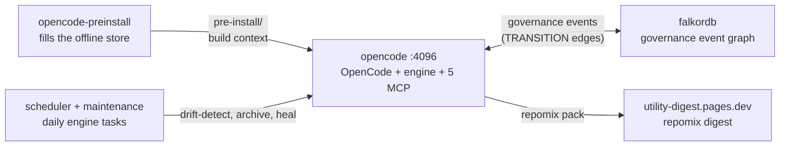

# The Agent Foundry

Containerized AI coding agents that plan, build, and ship under a scored, gated workflow.

<p>
  
  
  
  
  
  
</p>

## Table of Contents

1. [What this is](#what-this-is)
2. [Architecture](#architecture)
3. [Topology](#topology)
4. [Workflow engine at a glance](#workflow-engine-at-a-glance)
5. [Quick Start](#quick-start)
6. [Configuration at a glance](#configuration-at-a-glance)
7. [Project Structure](#project-structure)
8. [Documentation](#documentation)
9. [Offline store and certificates](#offline-store-and-certificates-pointers)
10. [Troubleshooting](#troubleshooting)
11. [Contributing and License](#contributing-and-license)

## What this is

A Docker Compose stack where AI coding agents do real work. The product is the OpenCode container under workspace/agents/opencode: it ships the Workflow State Engine (17 agents, 46 skills, contract-driven scoring), lean-ctx code intelligence, and five MCP servers, pre-populated for offline builds. Scratch work lives in workspace/sandbox, one folder per session.

The stack runs without network access after the first pull: rules, skills, MCP servers, plugins, and a package store travel inside the image. Versions resolve once at populate time and land in an audit manifest; the offline store is the lockfile.

## Architecture



| Service | Role |
|---|---|
| opencode | The product: OpenCode CLI, engine, five MCP servers, baked allowlist |
| falkordb | Graph store for the governance event pipe: one TRANSITION edge per contract state change |
| opencode-preinstall | Populates the offline package store (profile tools) |
| opencode-scheduler / opencode-maintenance | Daily drift-detect, archive, heal tasks (profile scheduler) |

## Topology

Inside the opencode container the engine talks to five MCP servers and two vendored plugins:

```mermaid
flowchart TB
    SERVE["opencode serve :4096"]
    subgraph ENG["Workflow State Engine (/opt/engine)"]
        AG["17 agents"]
        SK["46 skills"]
        GATES["contract + scoring gates<br/>rules + judge, score >= 70"]
    end
    subgraph MCP["5 registered MCP servers"]
        LC["lean-ctx<br/>code intelligence"]
        C7["context7<br/>library docs"]
        FE["fetch<br/>keyless HTTP GET"]
        RG["rag<br/>workspace index"]
        FKG["falkordb<br/>governance graph"]
    end
    PL["plugins<br/>firecrawl + workflow-guard"]
    SERVE --> ENG
    ENG --> MCP
    ENG --- PL
    GATES -->|"governance-event.sh<br/>spool"| FKG
```



## Workflow engine at a glance

- **State machine**: INIT -> PLAN -> PLAN_SCORED -> EXECUTE -> EXECUTE_SCORED -> REVIEW -> REVIEW_SCORED -> COMPLETE, with BLOCKED escalation; every transition is scored (rule checks + LLM judge, 70 or above passes).
- **Governance event pipe**: every successful state transition emits an event, and the spool drains into FalkorDB as (Task)-[:TRANSITION]->(State) edges.
- **Atomic lock release**: contract and loop-state mutations serialize through file locks; release moves the lockdir out of the namespace with one rename, so no waiter can observe a half-released lock.
- **Contention tolerance**: concurrent eval sections allow RACE_TOLERANCE_PCT percent (default 10) of lost lock events before failing.
- **Cross-model review**: reviewers and the tier-2 judge run sumopod/hy4-flash while the executor runs glm-5.3-flash, so no agent audits its own model's output.

## Quick Start

From the repository root:

```bash
cp workspace/agents/opencode/.env.template .env    # fill in OPENCODE_API_KEY, SUMOPOD_API_KEY, CONTEXT7_API_KEY
docker compose -f docker-compose.example.yaml --profile tools run --rm opencode-preinstall
docker compose -f docker-compose.example.yaml up -d --build
open http://[IP_ADDRESS]:4096                         # pairing screen, enter your key once
```

The first command fills the offline package store; repeat it to update the stack. The second builds the image and starts the opencode stack plus falkordb (the governance event graph). Add --profile scheduler for the daily maintenance containers. On a shared host, add the [socket proxy overlay](workspace/agents/opencode/README.md#socket-proxy-overlay) to keep the Docker API behind a filtered read-only proxy (opt-in; nothing breaks without it).

## Configuration at a glance

Full tables live in the opencode README. The essentials:

| Variable | Required | Purpose |
|---|---|---|
| OPENCODE_API_KEY | Yes | OpenCode auth; written to auth.json, then unset from the env |
| SUMOPOD_API_KEY | Yes | Primary provider (GLM 5.3 Flash executor; HY4 Flash light and reviewer tier) |
| CONTEXT7_API_KEY | Yes | Context7 docs MCP |
| OPENCODE_SERVER_PASSWORD | Recommended in production | Empty default leaves the server unauthenticated |
| FIRECRAWL_API_KEY | No | Firecrawl key; developer search works keyless |

## Project Structure

```text
utility/
├── docker-compose.example.yaml       # agent stack + falkordb
├── .github/workflows/                # validate.yml (CI gates), deploy-digest.yml (Pages digest)
└── workspace/
    ├── agents/
    │   └── opencode/                 # The product (see its README)
    ├── certs/                        # TLS trust store: detect-zscaler.sh + sync-certs.sh (single source)
    ├── pre-installer/                # Offline package store (single source; contents gitignored)
    ├── sandbox/                      # Session playground (rules in its README)
    └── infrastructure/               # Scaffolding only, no services yet
```

## Documentation

| Path | Covers |
|---|---|
| workspace/agents/opencode/ | The product: quick start, configuration, MCP servers, model policy, security notes, socket proxy overlay |
| workspace/agents/opencode/engine/ | Workflow State Engine reference: state machine, agents, scripts, scoring |
| workspace/agents/opencode/docs/opencode-workflow.md | Diagrams: offline store to runtime build flow, orchestration state machine |
| workspace/agents/opencode/docs/semantic-index-routing.md | When to use rag_search vs lean-ctx precision tools |
| workspace/sandbox/ | Session playground rules |
| workspace/certs/ | TLS certificate sourcing and mirroring |

## Offline store and certificates (pointers)

The offline package store, version resolution, and the corporate CA pipeline are documented in the opencode README and the certs scripts: workspace/certs/detect-zscaler.sh probes the wire and refreshes auto-detected roots; workspace/certs/sync-certs.sh mirrors the workspace-root set into the image build contexts.

## Troubleshooting

| Symptom | Fix |
|---|---|
| Build fetches fail behind a corporate proxy | Drop your CA .crt into workspace/certs/, run sh workspace/certs/sync-certs.sh, re-run the preinstall service, rebuild |
| Store stays on an old package version | The store is the lockfile: re-run the preinstall service (the ML closure refreshes only with REFRESH_ML=1) |
| An agent cannot run a command | Add it to config/lean-ctx-config.toml (with rationale) and rebuild, or run lean-ctx allow inside the container |
| Model provider errors at session start | Check SUMOPOD_API_KEY is set (primary) and OPENCODE_API_KEY is set (OpenCode auth) |
| Cloudflare Pages PR build fails: Unknown option: --exclude | The dashboard build command predates the workflow and uses the removed repomix flag; deploy-digest.yml PATCHes it back to sh scripts/pages-build.sh on every main push, or fix it once in the Pages dashboard |
| Governance events missing from FalkorDB | Ingest is best-effort: check the falkordb container is up and FALKORDB_HOST/FALKORDB_PORT resolve; the spool (session/governance-events.jsonl) is retained until it drains |

## Contributing and License

This is an internal repository and is not open for external contribution. Changes are made in place through pull requests, which run the validate workflow (JSON validity, shell syntax, cross-references, doc style, contract score) automatically. No LICENSE file ships with the repository; treat the contents as proprietary and for internal use only.
