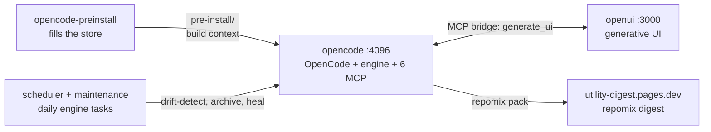

# The Agent Foundry

Containerized AI coding agents that plan, build, and ship under a scored, gated workflow.

<p>
  
  
  
  
  
</p>

## Table of Contents

1. [What this is](#what-this-is)
2. [Quick Start](#quick-start)
3. [Configuration](#configuration)
4. [Project Structure](#project-structure)
5. [Documentation](#documentation)
6. [Offline Package Store](#offline-package-store)
7. [Certificates](#certificates)
8. [Enforcement](#enforcement)
9. [Diagrams](#diagrams)
10. [Troubleshooting](#troubleshooting)
11. [Contributing and License](#contributing-and-license)

## What this is

A Docker Compose stack where AI coding agents do real work. The product is [workspace/agents/opencode/](workspace/agents/opencode/README.md): an OpenCode 2.2.5 container that ships the Workflow State Engine (17 agents, 45 skills, contract-driven scoring), lean-ctx code intelligence, and six MCP servers, all pre-populated for offline builds. A sidecar container, [workspace/agents/openui/](workspace/agents/openui/README.md), serves generative UI over the same GLM model and is reachable from the agents through an MCP bridge. Scratch work lives in [workspace/sandbox/](workspace/sandbox/README.md), one folder per session.

The stack is built so the image works without network access after the first pull: rules, skills, MCP servers, plugins, and a package store travel inside it. Versions are resolved once at populate time and recorded in an audit manifest, and the offline store is the real lockfile.

## Quick Start

From the repository root:

```bash
cp workspace/agents/opencode/.env.template .env    # fill in OPENCODE_API_KEY, SUMOPOD_*, CONTEXT7_API_KEY
docker compose -f docker-compose.example.yaml --profile tools run --rm opencode-preinstall
docker compose -f docker-compose.example.yaml up -d --build
open http://127.0.0.1:4096                         # pairing screen, enter your key once
```

The first command fills the offline package store (`workspace/agents/opencode/pre-install/`); repeat it whenever you want to update the stack. The second builds the image and starts `opencode` and `openui`. Add `--profile scheduler` to the `up` command to also start the daily drift-detect and maintenance containers.

Standalone build, without the repository compose file:

```bash
cd workspace/agents/opencode
docker build --build-context preinstall=./pre-install -t opencode:local .
```

## Configuration

Compose entry point: [`docker-compose.example.yaml`](docker-compose.example.yaml). Services: `opencode`, `openui`, `opencode-preinstall` (profile `tools`), `opencode-scheduler` and `opencode-maintenance` (profile `scheduler`).

### Runtime environment

| Variable | Required | Default | Description |
|---|---|---|---|
| `OPENCODE_API_KEY` | Yes | (empty) | OpenCode auth; written to `auth.json`, then unset from the env |
| `OPENCODE_SERVER_PASSWORD` | No | (empty) | Auth key for OpenCode's pairing screen |
| `SUMOPOD_API_KEY` | Yes | `REPLACE_ME` (openui only) | Model-provider API key |
| `SUMOPOD_BASE_URL` | No | `https://ai.sumopod.com/v1` | Model-provider endpoint |
| `SUMOPOD_BASE_MODEL` | No | `glm-5.3-flash` | Executor model id |
| `SUMOPOD_BASE_MODEL_NAME` | No | `glm-5.3-flash` | Executor model display name |
| `CONTEXT7_API_KEY` | Yes | (empty) | Context7 docs MCP key |
| `FIRECRAWL_API_KEY` | No | (empty) | Firecrawl key; developer search works keyless, alexandria and the firecrawl-cli skills need it |
| `GITHUB_TOKEN` | No | (empty) | GitHub API token for git-sourced store entries and release lookups |
| `RAG_EMBEDDINGS_URL` | No | (empty) | OpenAI-compatible `/v1/embeddings` endpoint for the rag server; all three `RAG_EMBEDDINGS_*` set switches it to remote embeddings |
| `RAG_EMBEDDINGS_MODEL` | No | (empty) | Embeddings model id at the endpoint above |
| `RAG_EMBEDDINGS_KEY` | No | (empty) | Bearer key for the embeddings endpoint |
| `OPENIDEA_VERSION` | No | auto-latest | openIdea image pin, resolved by the populate run |
| `OPENIDEA_MODE` | No | `web` | openIdea container mode: `web` (noVNC) or `x11` |
| `NOVNC_PORT` | No | `4190` | Host port for the openIdea web UI |
| `REFRESH_ML` | No | (unset) | Set to `1` to refresh the torch/transformers/sentence-transformers closure |
| `DOCKER_GID` | No | `101` | Host docker group id for the socket mount |

### Build args

| Arg | Required | Default | Description |
|---|---|---|---|
| `OPENCODE_ARCH` | No | auto (`TARGETARCH`) | Platform package arch; `x64` or `arm64`. Populate derives it from `uname -m`, the build from `TARGETARCH` |
| `OPENCODE_VERSION` | No | empty (store) | OpenCode CLI pin; empty means the store's `versions.lock` entry |
| `LEAN_CTX_VERSION` | No | empty (store) | lean-ctx pin; empty means the store's entry |
| `CONTEXT7_VERSION` | No | empty (store) | `@upstash/context7-mcp` pin; empty means the store's entry |

Version pins are deliberately absent from the compose file: an env value overrides the store, and the store's `versions.lock` is the reproducible record.

## Project Structure

```text
utility/
├── docker-compose.example.yaml       # 5 services: opencode, openui, opencode-preinstall, opencode-scheduler, opencode-maintenance
├── wrangler.toml                     # Empty placeholder; Pages deploy is CI-only (deploy-digest.yml)
├── .github/
│   ├── workflows/validate.yml        # CI: JSON validity, bash -n sweep, cross-reference integrity, doc style (humanizer), contract score, conventions (non-blocking)
│   ├── workflows/deploy-digest.yml   # CI: packs the agent stack with repomix, deploys to Cloudflare Pages (project utility-digest)
│   └── PULL_REQUEST_TEMPLATE.md      # PR description checklist
└── workspace/
    ├── agents/
    │   ├── opencode/                 # The product (see its README)
    │   │   ├── Dockerfile            # OpenCode 2.2.5 on node:22-bookworm-slim
    │   │   ├── entrypoint.sh         # Boot chain: auth, MCP preflight, optional engine self-check, serve (serve/web probe fallback)
    │   │   ├── config/               # opencode.json: 6 MCP servers, firecrawl plugin, 20 agents; lean-ctx config template; model fallback config; rag-usage.md
    │   │   ├── rag/                  # RAG MCP server (SQLite FTS5 + vectors)
    │   │   ├── engine/               # Workflow State Engine, copied to /opt/engine at build (see its README)
    │   │   ├── docs/                 # Workflow diagrams (build-to-runtime, orchestration state machine), git mirror notes
    │   │   ├── detect-zscaler.sh     # Probes the live wire for TLS interception, refreshes auto-detected certs
    │   │   ├── populate-preinstall.sh # Fills the offline store, resolves latest versions, writes versions.lock
    │   │   ├── pre-install/          # Offline package store, 6 sections (skeleton tracked, contents gitignored)
    │   │   ├── session/              # Live orchestration state (skeleton tracked, contents gitignored)
    │   │   ├── certs/                # TLS certificates: auto-detected plus manual (contents gitignored, skeleton tracked)
    │   │   ├── docker-compose.example.yaml # Standalone single-service compose, alternative to the root file
    │   │   └── .env.template         # Copy to repository-root .env
    │   ├── openui/                   # Generative-UI service (see its README)
    │   │   ├── app/                  # Next.js 16 + LangGraph scaffold, Dockerfile included
    │   │   ├── mcp-bridge.mjs        # stdio MCP bridge: generate_ui, preview_url
    │   │   ├── docker-compose.example.yaml # Standalone single-service compose
    │   │   └── .env.example
    │   └── tools/
    │       └── openIdea/             # Two-mode GUI container: web/noVNC on 4190, or x11
    │           ├── Dockerfile        # TARGETARCH-aware; pinned by OPENIDEA_VERSION
    │           └── certs/            # openIdea's own TLS trust store (contents gitignored)
    ├── sandbox/                      # Session playground (see its README): skeleton tracked, session folders gitignored
    ├── certs/                        # TLS mount point (gitignored, skeleton tracked)
    ├── documentation/wiki/           # NPG Confluence wiki publisher (see its README)
    └── infrastructure/               # Scaffolding only, no services yet: database/postgres, database/mssql, grafana, k6, vault
```

## Documentation

Each folder carries its own README; start there for detail:

| Path | Covers |
|---|---|
| [workspace/agents/opencode/](workspace/agents/opencode/README.md) | The product: quick start, configuration, MCP servers, architecture, quality gates, troubleshooting |
| [workspace/agents/opencode/engine/](workspace/agents/opencode/engine/README.md) | Workflow State Engine reference: state machine, agents, scripts, scoring |
| [workspace/agents/opencode/docs/opencode-workflow.md](workspace/agents/opencode/docs/opencode-workflow.md) | Diagrams: offline store to runtime build flow, orchestration state machine |
| [workspace/agents/openui/](workspace/agents/openui/README.md) | Generative-UI sidecar and its MCP bridge |
| [workspace/agents/tools/openIdea/](workspace/agents/tools/openIdea/README.md) | Dual-mode GUI container, noVNC and x11 |
| [workspace/sandbox/](workspace/sandbox/README.md) | Session playground rules |
| [workspace/documentation/wiki/](workspace/documentation/wiki/README.md) | Confluence wiki publisher |

## Offline Package Store

`workspace/agents/opencode/pre-install/` holds every third-party artifact the image needs, so builds run without network access. It is gitignored apart from `.gitkeep` placeholders and lives with the workspace volume, so a copied workspace carries a working store.

Six sections: `npm` (tarballs), `pip` (wheels), `bin` (release binaries such as lean-ctx), `apt` (`.deb` cache seeds), `git` (source mirrors), `dist` (direct-URL downloads).

- **Auto-latest.** `populate-preinstall.sh` resolves the current version of each package at populate time (npm registry for npm, PyPI JSON for wheels, the GitHub releases API for binaries). Re-running populate is the update-everything action. Set an env var (for example `OPENCODE_VERSION=2.2.5`) to pin a package instead. A resolver failure warns and falls back to the previous pin, so a registry hiccup never aborts a store build.
- **Audit manifest.** Each run writes `pre-install/versions.lock` recording every resolved version plus the store arch. It is the audit trail and the pin list for a reproducible re-run.
- **Frozen between runs.** The Dockerfile store tiers are glob-based and the store is the lockfile, so builds stay at whichever snapshot the store holds. Update by re-running populate, not by rebuilding.
- **Version-aware guards.** An artifact already present at the same version is skipped. A different version is fetched and the older copies of that package are pruned, which keeps the Dockerfile globs single-match. Pruning also runs on the skip path, so an older store self-heals. Dependency closures are add-only; the torch/transformers/sentence-transformers closure is huge and refreshes only when you ask: `REFRESH_ML=1 sh populate-preinstall.sh`.
- **Arch autodetect.** Populate reads `uname -m` (`x86_64` to `x64`, `aarch64` to `arm64`) and prunes tarballs for the other arch. The Dockerfile derives its arch from `TARGETARCH` (`amd64` to `x64`); `OPENCODE_ARCH` is an optional override for cross-builds.

## Certificates

`certs/` carries corporate MITM roots. `detect-zscaler.sh` probes the live wire on every populate run, so rotated roots are re-derived without manual work: it replaces only the `zscaler-autodetected-*.crt` set and never touches manual certificates you placed there. A failed probe changes nothing. The store build then installs everything in `certs/` into its trust store, and the image does the same at build time, so Node, pip, and git all trust the corporate proxy. The openIdea container keeps its own certificates in `workspace/agents/tools/openIdea/certs/`; drop a root there as well when that image build sits behind the same proxy.

## Enforcement

lean-ctx, the mandatory access layer for reads, search, and shell, ships a baked shell allowlist. Manage it in [`workspace/agents/opencode/config/lean-ctx-config.toml`](workspace/agents/opencode/config/lean-ctx-config.toml), which the Dockerfile copies to `/home/node/.config/lean-ctx/config.toml` in the image.

- Baseline: `shell_allowlist_extra = ["docker", "sh", "bash", "sudo", "ss"]`, merged onto lean-ctx's built-in read-only allowlist.
- Extend per environment: add the bare command name to that list and rebuild, or run `lean-ctx allow <cmd>` inside the container, which persists the entry to the same file.
- Candidates in the template, commented: `opencode` (lets in-container agents verify the CLI and engine version) and `ccc` (the local AST index server for the cocoindex-code MCP, which adds a model download and a CPU cost on first index).
- Escape hatches: `shell_allowlist = []` drops all extras, `shell_security = "off"` disables shell security checks entirely.

## Diagrams

All diagrams in this repository follow one standard: Mermaid blocks inside markdown, one diagram per concept, no binary images. The build-to-runtime flow and the orchestration state machine live in [opencode-workflow.md](workspace/agents/opencode/docs/opencode-workflow.md); the stack architecture in the [opencode README](workspace/agents/opencode/README.md); the engine state machine in the [engine README](workspace/agents/opencode/engine/README.md).



## Troubleshooting

| Symptom | Cause | Fix |
|---|---|---|
| Build fails fetching from GitHub behind the corporate proxy | The proxy re-signs TLS with a root the build does not trust | Drop your CA file (`.crt`) into `workspace/agents/opencode/certs/` for the opencode stack, or `workspace/agents/tools/openIdea/certs/` for openIdea, then re-run populate and rebuild |
| `EBADPLATFORM`, or a missing platform package on x64 | The store held arm64 tarballs; arch now follows `TARGETARCH` at build and `uname -m` at populate | One preinstall run self-heals the store (it prunes the other arch); then rebuild |
| Store stays on an old package version | The store is the lockfile, so a rebuild alone never moves a version | Re-run the preinstall service: a skip-path prune removes stale copies and a changed version is fetched. The ML closure refreshes only with `REFRESH_ML=1` |
| An agent cannot run a binary (for example `opencode` or `ccc`) | lean-ctx's baked allowlist does not include it | Add the bare name to `shell_allowlist_extra` in `config/lean-ctx-config.toml` and rebuild, or run `lean-ctx allow <cmd>` inside the container |

## Contributing and License

This is an internal repository and is not open for external contribution. Changes are made in place through pull requests, which run the `validate` workflow (JSON validity, shell syntax, cross-references, doc style, contract score) automatically. No LICENSE file ships with the repository; treat the contents as proprietary and for internal use only.