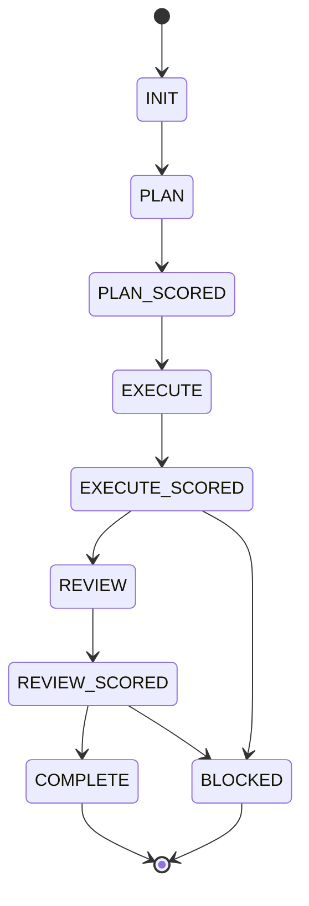

# utility

Personal agent workspace: a containerized OpenCode + Workflow State Engine stack plus infrastructure scaffolding.

[](https://github.com/RizkiRachman/utility/actions/workflows/validate.yml)


## About

This repository runs my AI coding environment in Docker. The product is [workspace/agents/opencode/](workspace/agents/opencode/README.md): an OpenCode 2.2.5 container that ships the Workflow State Engine (16 agents, 66 skills, contract-driven scoring), lean-ctx code intelligence, and a set of MCP servers, all version-pinned and pre-populated for offline builds. The `workspace/infrastructure/` tree holds empty scaffolding for services planned later. One compose file and one env file configure everything.

## Table of Contents

1. [Quick Start](#quick-start)
2. [Services](#services)
3. [Configuration](#configuration)
4. [Project Structure](#project-structure)
5. [The Agent Stack](#the-agent-stack)
6. [Infrastructure](#infrastructure)
7. [FAQ](#faq)
8. [Contributing and License](#contributing-and-license)

## Quick Start

Prerequisite: Docker with compose v2. From the repository root:

```bash
cp workspace/agents/opencode/.env.template .env   # then fill in your keys
docker compose -f docker-compose.example.yaml up -d --build
docker exec -it opencode opencode                 # attach to the agent TUI
```

The web UI binds to `127.0.0.1:4097` on the host (container port 4096). The first build downloads packages from the network; the optional offline store below removes that need for later rebuilds.

Optional services:

```bash
# fill the offline package store (one-time, needs network)
docker compose -f docker-compose.example.yaml --profile tools run --rm opencode-preinstall

# daily drift detection between engine knowledge and files
docker compose -f docker-compose.example.yaml --profile scheduler up -d opencode-scheduler
```

## Services

| Service | Profile | Purpose |
|---|---|---|
| `opencode` | default | The agent stack. OpenCode on `127.0.0.1:4097`, 3 GB memory, 2 CPUs, restart unless-stopped |
| `opencode-preinstall` | `tools` | One-shot container that fills `workspace/agents/opencode/pre-install/` with apt, pip, and npm packages for offline builds |
| `opencode-scheduler` | `scheduler` | Runs `scripts/scheduled-runner.sh` with the `drift-detect` task daily against the mounted workspace |

## Configuration

Copy `workspace/agents/opencode/.env.template` to `.env` at the repository root. Every value is optional; compose carries working defaults. OpenCode auth requires only `OPENCODE_API_KEY`.

| Variable | Default | Description |
|---|---|---|
| `OPENCODE_API_KEY` | (empty) | OpenCode auth; written to `auth.json` at boot, then unset from the environment |
| `SUMOPOD_API_KEY` | (empty) | Model provider API key |
| `SUMOPOD_BASE_URL` | `https://ai.sumopod.com/v1` | Model provider endpoint |
| `SUMOPOD_BASE_MODEL` | `glm-5.3-flash` | Executor model id |
| `SUMOPOD_BASE_MODEL_NAME` | `glm-5.3-flash` | Executor model display name |
| `CONTEXT7_API_KEY` | (empty) | Context7 docs MCP |
| `GITHUB_TOKEN` | (empty) | GitHub API token |
| `FIRECRAWL_API_KEY` | (empty) | Optional. Developer search works keyless; scrape, crawl, and alexandria need it |

Runtime knobs that are not env-driven (`OPENCODE_AUTH_REQUIRED=true`, `GRAPHIFY_ROOT`, `GRAPHIFY_BUILD=if-missing`, `GRAPHIFY_TIMEOUT=900`) are set directly in the compose file. Pinned build args (`OPENCODE_VERSION`, `GRAPHIFY_VERSION`, `LEAN_CTX_VERSION`, `CONTEXT7_VERSION`, `MCP_VERSION`, `MCP_SERVER_FETCH_VERSION`) live in the compose build section.

## Project Structure

```text
utility/
├── docker-compose.example.yaml       # 3 services: opencode, opencode-preinstall, opencode-scheduler
├── .github/
│   └── workflows/validate.yml        # CI: JSON validity, bash -n, doc checks, contract score
└── workspace/
    ├── agents/
    │   └── opencode/                 # The product (see its README)
    │       ├── Dockerfile            # OpenCode 2.2.5 on node:22-bookworm-slim
    │       ├── docker-compose.example.yaml
    │       ├── entrypoint.sh         # Boot chain: auth, graphify, MCP preflight, serve
    │       ├── config/               # opencode.json: MCP servers, plugins, 20 agent entries
    │       ├── engine/               # Workflow State Engine, copied to /opt/engine at build
    │       ├── pre-install/          # Offline package store (gitignored)
    │       ├── session/              # Live orchestration state (gitignored)
    │       └── .env.template         # Copy to repository-root .env
    └── infrastructure/               # Scaffolding only, no services yet
        ├── database/mssql/
        ├── database/postgres/
        ├── grafana/
        ├── k6/
        └── vault/
```

## The Agent Stack

[workspace/agents/opencode/](workspace/agents/opencode/README.md) documents the image, configuration, MCP servers, health checks, and troubleshooting. The engine inside it has its own reference: [workspace/agents/opencode/engine/README.md](workspace/agents/opencode/engine/README.md).

The engine drives every task through a gated state machine:



Any state can escalate to `BLOCKED` when a score lands below 50 or a task exhausts its 3 retries. Scores gate transitions: 70 or above passes, 50-69 retries. The live envelope is `workspace/agents/opencode/session/contract.json`.

## Infrastructure

Empty scaffolding for planned services. Each directory currently holds only placeholder files:

| Directory | Intended for |
|---|---|
| `workspace/infrastructure/database/mssql` | SQL Server instance |
| `workspace/infrastructure/database/postgres` | PostgreSQL instance |
| `workspace/infrastructure/grafana` | Dashboards |
| `workspace/infrastructure/k6` | Load tests |
| `workspace/infrastructure/vault` | Secrets |

No compose service references these yet.

## FAQ

**Why the offline package store?**
The Dockerfile installs apt, pip, and npm packages from `workspace/agents/opencode/pre-install/`, which is mounted as a build context. With the store empty, installs fall back to the network and fail in offline environments. The `opencode-preinstall` service fills it once; repeat runs skip what is already present.

**What does the scheduler do?**
The `opencode-scheduler` service runs `scripts/scheduled-runner.sh` with the `drift-detect` task on a daily schedule. It compares persisted engine knowledge against the files in the workspace and reports drift.

**Where does session state live?**
In `workspace/agents/opencode/session/`: `contract.json` (the live orchestration envelope), `state.md` (append-only log), and `archive/` (snapshots). It is gitignored except for `state.example.md`, which documents the format.

**How do I update pinned versions?**
Bump the build args in `docker-compose.example.yaml` (repository root) and the matching `ARG` defaults in `workspace/agents/opencode/Dockerfile`, then re-run the `opencode-preinstall` profile so the offline store picks up the new versions, and rebuild.

## Contributing and License

This is a personal workspace and not open for external contribution. No LICENSE file ships with the repository; treat the contents as proprietary and internal use only.
