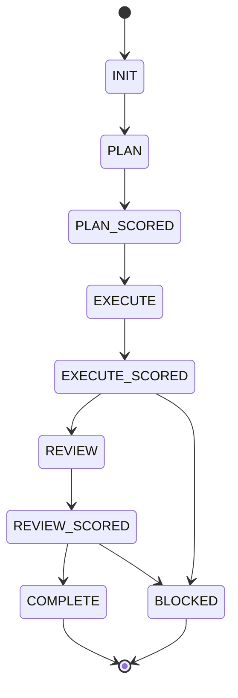
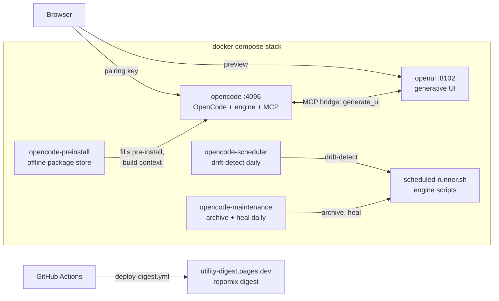

# utility

Personal agent workspace: a containerized OpenCode + Workflow State Engine stack plus infrastructure scaffolding.

[](https://github.com/RizkiRachman/utility/actions/workflows/validate.yml)


## About

This repository runs my AI coding environment in Docker. The product is [workspace/agents/opencode/](workspace/agents/opencode/README.md): an OpenCode 2.2.5 container that ships the Workflow State Engine (17 agents, 45 skills, contract-driven scoring), lean-ctx code intelligence, and four MCP servers (Context7, fetch, lean-ctx, rag), all version-pinned and pre-populated for offline builds. A second container, [workspace/agents/openui/](workspace/agents/openui/README.md), serves generative UI over the same GLM model and is reachable from OpenCode through an MCP bridge. Scratch work lives in [workspace/sandbox/](workspace/sandbox/README.md), one folder per session, gitignored. The `workspace/infrastructure/` tree holds empty scaffolding for services planned later. One compose file and one env file configure everything.

## Table of Contents

1. [Quick Start](#quick-start)
2. [Services](#services)
3. [Configuration](#configuration)
4. [Project Structure](#project-structure)
5. [The Agent Stack](#the-agent-stack)
6. [Infrastructure](#infrastructure)
7. [FAQ](#faq)
8. [Contributing and License](#contributing-and-license)

## Quick Start

Prerequisite: Docker with compose v2. From the repository root:

```bash
cp workspace/agents/opencode/.env.template .env   # then fill in your keys
docker compose -f docker-compose.example.yaml up -d --build
open http://127.0.0.1:4096   # enter your key once
```

OpenCode publishes directly on `127.0.0.1:4096` (loopback only). On first visit OpenCode shows its own pairing screen; enter `OPENCODE_SERVER_PASSWORD` from your `.env` there. The first build downloads packages from the network; the optional offline store below removes that need for later rebuilds. The generative-UI sidecar comes up on `http://127.0.0.1:8102` (loopback only). To attach a TUI instead, run `docker exec -it opencode opencode`.

Optional services:

```bash
# fill the offline package store (one-time, needs network)
docker compose -f docker-compose.example.yaml --profile tools run --rm opencode-preinstall

# daily drift detection between engine knowledge and files
docker compose -f docker-compose.example.yaml --profile scheduler up -d opencode-scheduler opencode-maintenance
```

## Services

| Service | Profile | Purpose |
|---|---|---|
| `opencode` | default | The agent stack. OpenCode serve published on `127.0.0.1:4096` (loopback only), 3 GB memory, 2 CPUs, restart unless-stopped |
| `openui` | default | Generative-UI sidecar (Next.js + LangGraph) calling the same GLM model, published on `127.0.0.1:8102` (loopback only), 2 GB memory, healthchecked. OpenCode reaches it through the `openui` MCP bridge, which exposes `generate_ui` and `preview_url` |
| `opencode-preinstall` | `tools` | One-shot container that fills `workspace/agents/opencode/pre-install/` with apt, pip, and npm packages for offline builds |
| `opencode-scheduler` | `scheduler` | Runs `scripts/scheduled-runner.sh` with the `drift-detect` task daily against the mounted workspace |
| `opencode-maintenance` | `scheduler` | Runs the scheduled-runner `archive` and `heal` tasks daily: archives old session snapshots, retries a failing contract validation |

## Configuration

Copy `workspace/agents/opencode/.env.template` to `.env` at the repository root. Every value is optional; compose carries working defaults. OpenCode auth requires only `OPENCODE_API_KEY`.

| Variable | Default | Description |
|---|---|---|
| `OPENCODE_API_KEY` | (empty) | OpenCode auth; written to `auth.json` at boot, then unset from the environment |
| `OPENCODE_SERVER_PASSWORD` | (empty) | Auth key for OpenCode's own HTTP basic auth / pairing screen |
| `SUMOPOD_API_KEY` | (empty) | Model provider API key, shared by the `opencode` and `openui` containers |
| `SUMOPOD_BASE_URL` | `https://ai.sumopod.com/v1` | Model provider endpoint |
| `SUMOPOD_BASE_MODEL` | `glm-5.3-flash` | Executor model id |
| `SUMOPOD_BASE_MODEL_NAME` | `glm-5.3-flash` | Executor model display name |
| `CONTEXT7_API_KEY` | (empty) | Context7 docs MCP |
| `GITHUB_TOKEN` | (empty) | GitHub API token |
| `FIRECRAWL_API_KEY` | (empty) | Optional. Developer search works keyless; scrape, crawl, and alexandria need it |
| `RAG_EMBEDDINGS_URL` | (empty) | Optional. Upgrade rag from offline hashed vectors to an OpenAI-compatible embeddings endpoint |
| `RAG_EMBEDDINGS_MODEL` | (empty) | Embeddings model id at that endpoint |
| `RAG_EMBEDDINGS_KEY` | (empty) | Embeddings API key |

Runtime knobs that are not env-driven (`OPENCODE_AUTH_REQUIRED=true`, `GRAPHIFY_ROOT`, `GRAPHIFY_BUILD=if-missing`, `GRAPHIFY_TIMEOUT=900`) are set directly in the compose file. Pinned build args (`OPENCODE_VERSION`, `GRAPHIFY_VERSION`, `LEAN_CTX_VERSION`, `CONTEXT7_VERSION`, `MCP_VERSION`, `MCP_SERVER_FETCH_VERSION`) live in the compose build section. The config directory also mounts `opencode-model-fallback.json` read-only: on 401/402/403/429/5xx replies or rate-limit patterns, OpenCode retries and falls back to `sumopod/deepseek-flash` (5 attempts, 60 s cooldown).

## Project Structure

```text
utility/
├── docker-compose.example.yaml       # 5 services: opencode, openui, opencode-preinstall, opencode-scheduler, opencode-maintenance
├── wrangler.toml                     # Empty placeholder; Pages deploy is CI-only (deploy-digest.yml)
├── .github/
│   ├── workflows/validate.yml        # CI: JSON validity, bash -n sweep, cross-reference integrity, doc style (humanizer), contract score, conventions (non-blocking)
│   ├── workflows/deploy-digest.yml   # CI: packs the agent stack with repomix, deploys to Cloudflare Pages (project utility-digest)
│   └── PULL_REQUEST_TEMPLATE.md      # PR description checklist
└── workspace/
    ├── agents/
    │   ├── opencode/                 # The product (see its README)
    │   │   ├── Dockerfile            # OpenCode 2.2.5 on node:22-bookworm-slim
    │   │   ├── entrypoint.sh         # Boot chain: auth, graphify, MCP preflight, optional engine self-check, serve (serve/web probe fallback)
    │   │   ├── config/               # opencode.json: 4 MCP servers, firecrawl plugin, 20 agents; model fallback config; rag-usage.md
    │   │   ├── rag/                  # RAG MCP server (SQLite FTS5 + vectors)
    │   │   ├── engine/               # Workflow State Engine, copied to /opt/engine at build
    │   │   ├── populate-preinstall.sh # Fills the offline store; runs inside the opencode-preinstall container
    │   │   ├── pre-install/          # Offline package store (skeleton tracked, contents gitignored)
    │   │   ├── session/              # Live orchestration state (skeleton tracked, contents gitignored)
    │   │   ├── certs/                # TLS mount point (gitignored, skeleton tracked)
    │   │   ├── docker-compose.example.yaml # Standalone single-service compose, alternative to the root file
    │   │   └── .env.template         # Copy to repository-root .env
    │   └── openui/                   # Generative-UI service (see its README)
    │       ├── app/                  # Next.js 16 + LangGraph scaffold, Dockerfile included
    │       ├── mcp-bridge.mjs        # stdio MCP bridge: generate_ui, preview_url
    │       ├── docker-compose.example.yaml # Standalone single-service compose
    │       ├── .env.example
    │       └── compose-service.yml   # Fragment already pasted into the root compose
    ├── sandbox/                      # Session playground: skeleton tracked, session folders gitignored
    ├── certs/                        # TLS mount point (gitignored, skeleton tracked)
    ├── documentation/wiki/           # NPG Confluence wiki publisher (publish.sh, scope/style gates, tests)
    └── infrastructure/               # Scaffolding only, no services yet
        ├── database/postgres/
        ├── database/mssql/
        ├── grafana/
        ├── k6/
        └── vault/
```

## The Agent Stack

[workspace/agents/opencode/](workspace/agents/opencode/README.md) documents the image, configuration, MCP servers, health checks, and troubleshooting. The engine inside it has its own reference: [workspace/agents/opencode/engine/README.md](workspace/agents/opencode/engine/README.md).

The engine drives every task through a gated state machine:



Any state can escalate to `BLOCKED` when a score lands below 50 or a task exhausts its 3 retries. Scores gate transitions: 70 or above passes, 50-69 retries. The live envelope is `workspace/agents/opencode/session/contract.json`.

### Architecture Flow



Every container has one job:

- **opencode**: the product. OpenCode serve plus the workflow-state-engine (17 agents, gated state machine), lean-ctx, and five MCP servers.
- **openui**: generative UI sidecar. Agents call it through the MCP bridge; humans preview on :8102.
- **opencode-scheduler**: runs `drift-detect` daily, comparing persisted engine knowledge against workspace files.
- **opencode-maintenance**: runs `archive` (session snapshot cleanup) and `heal` (retry a failing contract validation) daily.
- **opencode-preinstall**: one-shot filler for the offline package store used as a Docker build context.

On every push, GitHub Actions validates the tree (JSON, shell syntax, cross-references, doc style, contract score) and repacks `workspace/agents/opencode/**` for agent consumption on Cloudflare Pages.


## Infrastructure

Empty scaffolding for planned services. Each directory currently holds only placeholder files:

| Directory | Intended for |
|---|---|
| `workspace/infrastructure/database/postgres` | PostgreSQL instance |
| `workspace/infrastructure/database/mssql` | Microsoft SQL Server instance |
| `workspace/infrastructure/grafana` | Dashboards |
| `workspace/infrastructure/k6` | Load tests |
| `workspace/infrastructure/vault` | Secrets |

No compose service references these yet.

## FAQ

- **Why the offline package store?** The Dockerfile installs apt, pip, and npm packages from `workspace/agents/opencode/pre-install/`, mounted as a build context. With the store empty, installs fall back to the network. The `opencode-preinstall` service fills it once; repeat runs skip what is already present.
- **What do the scheduler services do?** `opencode-scheduler` runs `scripts/scheduled-runner.sh` with the `drift-detect` task daily, comparing persisted engine knowledge against workspace files. `opencode-maintenance` runs the `archive` and `heal` tasks daily: archiving old session snapshots and retrying a failing contract validation.
- **How can AI agents consume this repository?** Every push to `main` triggers `.github/workflows/deploy-digest.yml`, which packs `workspace/agents/opencode/**` into a plain-text digest with [repomix](https://github.com/yamadashy/repomix) and deploys it to Cloudflare Pages (project `utility-digest`). Agents read the deployed `repomix-output.txt` instead of cloning. The deploy is CI-only; `wrangler.toml` is an empty placeholder kept for local experiments.
- **Where does session state live?** In `workspace/agents/opencode/session/`: `contract.json` (the live orchestration envelope), `state.md` (append-only log), and `archive/` (snapshots). Gitignored except for `state.example.md`, which documents the format.
- **Where does scratch work go?** In `workspace/sandbox/<session-slug>/`, one folder per live session. The skeleton is tracked; session folders are gitignored, so probes, clones, and rendered tests never reach the repository. Promote anything durable before a session ends; rules are in `workspace/sandbox/README.md`.
- **What is openui?** A self-hosted generative-UI service from the [thesysdev/openui](https://github.com/thesysdev/openui) scaffold, patched to call the GLM model directly. Browser UI on `127.0.0.1:8102`; OpenCode agents reach it through the `openui` MCP bridge (`generate_ui`, `preview_url`). See `workspace/agents/openui/README.md`.
- **Where do I sign in?** OpenCode's web UI is published directly on `127.0.0.1:4096` (loopback only). The first visit shows OpenCode's pairing screen; enter `OPENCODE_SERVER_PASSWORD` there. HTTP Basic auth checks the key directly; no proxy in between.
- **How do I update pinned versions?** Bump the build args in `docker-compose.example.yaml` and the matching `ARG` defaults in `workspace/agents/opencode/Dockerfile`, re-run the `opencode-preinstall` profile so the offline store picks up the new versions, then rebuild.
- **What does the rag server index?** The `rag` MCP server indexes `/home/node/workspace` by default: markdown per heading, Java per method, other text per paragraph. It skips binaries, files above 512 KB, build output, lockfiles, and vendored or transient directories (`.git`, `node_modules`, `dist`, `pre-install`, `session`). Indexing is incremental and hash based. Usage rules load automatically from `opencode/config/rag-usage.md`.


## Contributing and License

This is a personal workspace and not open for external contribution. No LICENSE file ships with the repository; treat the contents as proprietary and internal use only.
