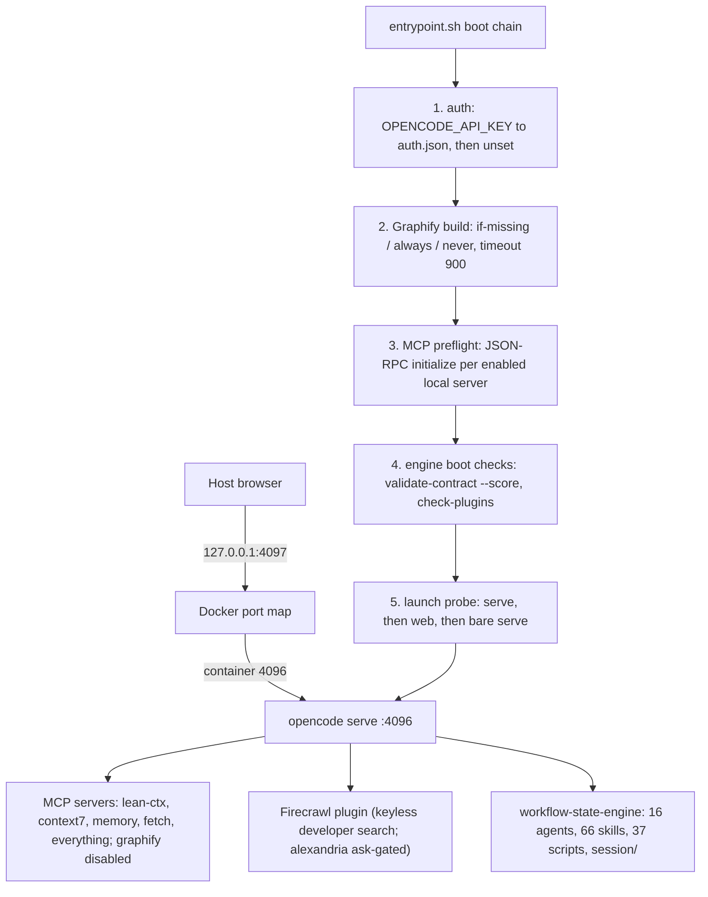

<!-- omit from toc -->
# opencode

Self-hosted OpenCode v2 stack in Docker: workflow-state-engine, lean-ctx, Graphify, MCP servers, kept separate from v1.


This folder packages OpenCode v2 (`@opencode/cli`, npm `anomalyco/opencode`) as a reproducible Docker stack: the workflow-state-engine (16 agents, 66 skills, contract-driven scoring), lean-ctx, Graphify, and Context7 / memory / fetch / everything MCP servers, all version-pinned and pre-populated for offline builds. OpenCode v2 is early software, so this runs as a **beta experience**, fully separate from the stable v1 project at `../opencode` (own folder, own compose project, own port) so both stacks can run side by side. The engine itself is documented in [engine/README.md](engine/README.md).

## Table of Contents

1. [Quick Start](#quick-start)
2. [Configuration](#configuration)
3. [Components](#components)
4. [Project Structure](#project-structure)
5. [Architecture](#architecture)
6. [Enforcement & Quality Gates](#enforcement--quality-gates)
7. [Known Unknowns](#known-unknowns)
8. [Local State](#local-state)
9. [Contributing & License](#contributing--license)

## Quick Start

```sh
cd /path/to/opencode
export OPENCODE_API_KEY=... SUMOPOD_API_KEY=... SUMOPOD_BASE_URL=... \
       SUMOPOD_BASE_MODEL=... SUMOPOD_BASE_MODEL_NAME=... CONTEXT7_API_KEY=...
docker compose -f docker-compose.example.yaml run --rm populate   # fills pre-install/ (first run downloads)
docker compose -f docker-compose.example.yaml up -d --build
# UI on http://localhost:4097 (v1 stays on 4096)
# opt-in: daily drift detection scheduler
docker compose -f docker-compose.example.yaml --profile scheduler up -d scheduler
```

`populate` is a throwaway `node:22-bookworm-slim` container (profile `tools`) that fills the offline store in `pre-install/`; repeat runs skip everything already present. The image build consumes that store via the `preinstall` build context; without it, installs fall back to the network and fail in offline environments.

## Configuration

Compose file: [`docker-compose.example.yaml`](docker-compose.example.yaml). Host port binding is `127.0.0.1:4097 → container 4096`.

### Runtime environment

| Variable | Required | Default | Description |
|---|---|---|---|
| `OPENCODE_API_KEY` | Yes | `REPLACE_ME` | OpenCode auth; written to `auth.json`, then unset from the env |
| `SUMOPOD_API_KEY` | Yes | `REPLACE_ME` | Model-provider API key |
| `SUMOPOD_BASE_URL` | Yes | `REPLACE_ME` | Model-provider endpoint |
| `SUMOPOD_BASE_MODEL` | Yes | `REPLACE_ME` | Executor model id |
| `SUMOPOD_BASE_MODEL_NAME` | Yes | `REPLACE_ME` | Executor model display name |
| `CONTEXT7_API_KEY` | Yes | `REPLACE_ME` | Context7 docs MCP key |
| `OPENCODE_AUTH_REQUIRED` | No | `true` | Fail boot when `OPENCODE_API_KEY` is missing |
| `OPENCODE_CONFIG` | No | `/home/node/.config/opencode/opencode.json` | Config path inside the container |
| `GRAPHIFY_ROOT` | No | `/home/node/workspace` | Graphify index root |
| `GRAPHIFY_BUILD` | No | `if-missing` | `if-missing` / `always` / `never` |
| `GRAPHIFY_TIMEOUT` | No | `900` | Graph build timeout (seconds) |
| `MCP_CHECK_ENABLED` | No | `true` | Boot-time MCP readiness preflight |
| `MCP_CHECK_TIMEOUT` | No | `20` | Per-server probe timeout (seconds) |
| `MCP_CHECK_STRICT` | No | `false` | Exit 1 when a server is not ready |
| `ENGINE_BOOT_CHECK` | No | `false` | Validate the bundled engine before launch |
| `ENGINE_BOOT_STRICT` | No | `false` | Exit 1 when a boot check fails |
| `ENGINE_BOOT_TIMEOUT` | No | `30` | Per-check timeout (seconds) |
| `FIRECRAWL_API_KEY` | No | (unset) | Firecrawl key; developer search works keyless, alexandria + firecrawl-cli skills need it |

### Build args

| Arg | Default | Description |
|---|---|---|
| `OPENCODE_VERSION` | `2.2.5` | OpenCode CLI pin |
| `OPENCODE_ARCH` | `arm64` | Platform package (`@opencode/cli-linux-arm64`); x64 builds override |
| `GRAPHIFY_VERSION` | `0.9.100` | `graphifyy[mcp]` pin (PyPI) |
| `LEAN_CTX_VERSION` | `3.12.0` | lean-ctx pin |
| `CONTEXT7_VERSION` | `4.4.4` | `@upstash/context7-mcp` pin |
| `MCP_VERSION` | `2.3.0` | MCP Python SDK pin |
| `MCP_SERVER_FETCH_VERSION` | `2026.10.28` | `mcp-server-fetch` pin |
| `ZOD_VERSION` | `4.1.8` | zod pin (runtime dep of `@firecrawl/opencode`, resolved once) |
| `FIRECRAWL_CLI_VERSION` | `1.26.24` | `firecrawl-cli` pin (binary `firecrawl`) |

Config files: `config/opencode.json` (V2-native schema: `agents`, `permissions` (incl. a `firecrawl_alexandria` ask entry), `plugins` (vendored `/opt/engine/plugins/opencode-firecrawl`), `mcp.servers` + `disabled`, `providers.package`, `update`, `compaction.keep.tokens`; mounted read-only) and `config/opencode-model-fallback.json` (dormant, kept for a future `@opencode/plugin` port).

## Components

| Component | Pin | Source |
|---|---|---|
| OpenCode v2 CLI | `@opencode/cli@2.2.5` + platform pkg `@opencode/cli-linux-${OPENCODE_ARCH}@2.2.5` | npm (`anomalyco/opencode`) |
| Context7 MCP | `@upstash/context7-mcp@4.4.4` | npm |
| Memory MCP | `@modelcontextprotocol/server-memory@2.0.1` | npm |
| Everything MCP | `@modelcontextprotocol/server-everything@2.1.0` | npm |
| Graphify | `graphifyy[mcp]==0.9.100` | PyPI |
| MCP Python SDK | `mcp==2.3.0` | PyPI |
| Fetch MCP | `mcp-server-fetch==2026.10.28` | PyPI |
| lean-ctx | `v3.12.0` | [GitHub release](https://github.com/yvgude/lean-ctx) |
| @firecrawl/opencode | `1.4.0` (ISC, first-party) | vendored at `engine/plugins/opencode-firecrawl` ([upstream](https://github.com/firecrawl/opencode-firecrawl)) |
| firecrawl-cli | `1.26.24` (ISC, binary `firecrawl`) | npm |

**Custom plugins removed** (`@razroo/opencode-model-fallback@0.3.2`, `@tarquinen/opencode-dcp@3.2.0`, `opencode-websearch-cited@1.2.0`): they target the V1 plugin API and V2 additionally rejects their old `file://<file>` entries (`configured plugin path must be a directory`), so they never loaded. They are dropped from the image and `config/opencode.json` until ported to the `@opencode/plugin` V2 API; no fallback executor→reviewer resilience is active until then. Contrast: the first-party V2-native `@firecrawl/opencode` plugin is adopted offline-vendored at `engine/plugins/opencode-firecrawl` (developer search works keyless out of the box); the community V1-era plugins above remain removed.

## Project Structure

```text
opencode/
├── Dockerfile                   # Image build; consumes the preinstall context
├── entrypoint.sh                # Boot chain: auth → graphify → MCP preflight → serve
├── docker-compose.example.yaml  # opencode + populate + scheduler services
├── populate-preinstall.sh       # Offline-store bootstrap (run inside populate)
├── config/                      # opencode.json (V2-native), dormant fallback config
├── certs/                       # TLS certs placeholder (currently empty)
├── pre-install/                 # Offline package store (apt/pip/npm/git/bin/dist)
├── session/                     # Live orchestration contract + state log
├── .github/                     # validate.yml CI + PR template
└── engine/                      # Workflow-state-engine → copied to /opt/engine
    ├── agent.md                 # Orchestrator instructions (instructions[0])
    ├── agents/                  # 16 agent instruction files
    ├── skills/                  # 66 skill directories
    ├── commands/                # 1 slash command (impeccable)
    ├── rules/                   # rules.json + rules.schema.json
    ├── contract/                # Contract templates + JSON Schema
    ├── scripts/                 # 37 automation & validation scripts
    ├── usage/                   # 4 tool guides (lean-ctx, graphify, context7, opencode)
    ├── doc/                     # Workflow + health-check docs
    ├── templates/               # judge-prompt.md
    └── opencode.json.template   # Config template (V2-native shape)
```

## Architecture



## Enforcement & Quality Gates

All gates exist and are wired; details in [engine/doc/health-check.md](engine/doc/health-check.md). No CI badge is shown: this copy is intentionally not a git repository, so a passing badge would be untruthful.

| Gate | Checks | Wired into |
|---|---|---|
| `engine/scripts/check-cross-references.sh` | 8-check link/ID integrity + context-standards + access-policy verification | `health-check.sh` lens-4, `validate-toolkit.sh`, pre-commit hook, CI |
| `engine/scripts/check-doc-style.sh` | Doc style gate: em/en dashes, AI vocabulary, placeholders in shipped docs | `health-check.sh --check docs`, `validate-toolkit.sh`, pre-commit hook, CI |
| `engine/scripts/check-plugins.sh` | Rejects `file://`-to-file plugin paths (V2 rule) | `setup.sh`, `validate-toolkit.sh`, engine boot checks |
| `engine/scripts/validate-contract.sh --score` | 3-tier contract scoring (PASS ≥ 70) | CI, engine boot checks |
| `engine/scripts/check-conventions.sh` | Rule 1 FAILs stale contract paths; INFOs the V2 chain | `validate-toolkit.sh`, CI (non-blocking) |
| `engine/rules/rules.schema.json` | `store_in` target schema + required top-level keys for rules | `validate-toolkit.sh` |
| `engine/.githooks/pre-commit` | `bash -n` sweep + cross-references + doc style | `git config core.hooksPath engine/.githooks` |
| `.github/workflows/validate.yml` | JSON validity, `bash -n`, cross-refs, doc style, contract score, conventions | Activates once this folder lands in a git remote |
| humanizer gate (`/skill humanizer`) | Strips AI writing patterns (em dashes, rule-of-three, promotional tone) from shipped user-facing docs; internal state files (`session/state.md`, contract JSON, code comments) exempt | `agent.md` ship flow, `engine/skills/release-plan`, `engine/skills/shipping-and-launch` |
| context gate (`/skill context-standards`) | Loads target-project pattern standards (`context/*.md`) before edits and verifies them in review | `agent.md` Execute step, `developer.md`, `quality-analyst.md`, cross-reference check 7 |

## Known Unknowns

- **V2 config schema** (resolved as of 2026-11-01): `config/opencode.json` migrated to the V2-native shape; deprecated keys (`agent`, `permission`, `mcp.<name>`, `autoupdate`, `compaction.reserved`, `bash`) must not be reintroduced.
- **Plugin API**: the three custom plugins were removed (see [Components](#components)); port them to `@opencode/plugin@2.x` before re-adding.
- **`opencode web` flags**: v2 CLI subcommands are not fully verified. `entrypoint.sh` probes at boot: `opencode serve --hostname … --port …` → fallback `opencode web --hostname … --port …` → fallback bare `opencode serve`.

## Local State

Never committed or pushed:

- `pre-install/`: offline package store (gitignored except `.gitkeep` placeholders).
- `session/`: **project-local runtime state**. Compose mounts this project at `/home/node/workspace`, so this `session/` *is* the container's global session directory: `contract.json` (seeded from `engine/contract/contract.template.json` via `snapshot-contract.sh`), `state.md`, `state.example.md` (tracked), `archive/`. Gitignore policy: `session/*` ignored, `state.example.md` negated.

This folder is intentionally **not a git repository**; v1 at `../opencode` remains the versioned source of truth. See [PLAN.md](PLAN.md) for the migration analysis.

## Contributing & License

The stack is internal and not open for external contribution. The v1 repository is the versioned source of truth; changes here are made in place. A PR template (`.github/PULL_REQUEST_TEMPLATE.md`) and the CI workflow ship so the usual gates apply automatically once this folder lands in a git remote; until then, run `engine/.githooks/pre-commit` checks by hand. No license file ships with this copy.
