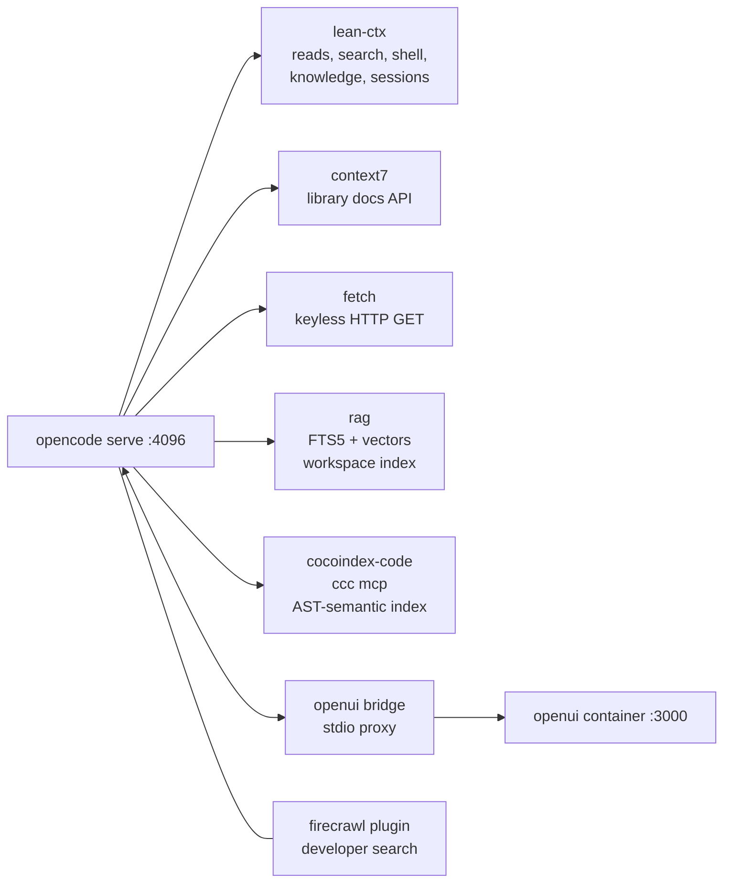
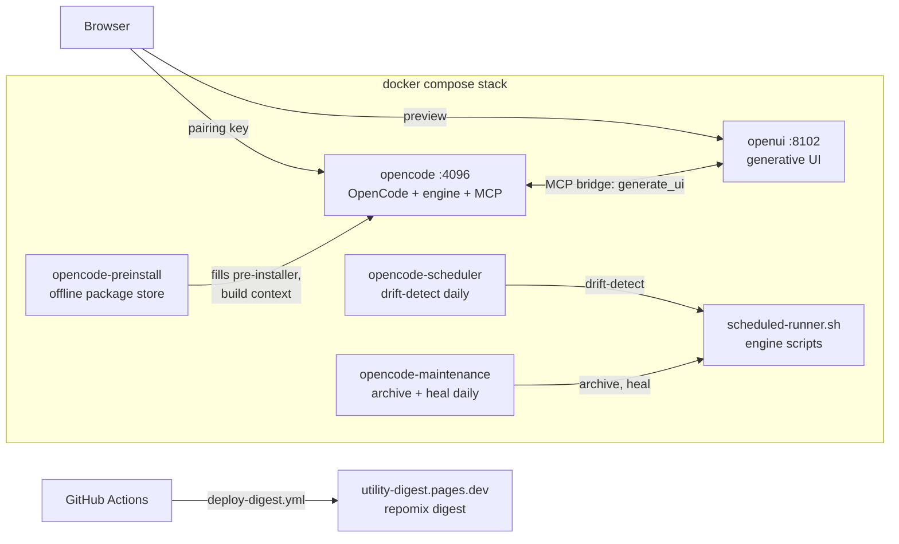

<!-- omit from toc -->
# opencode

Self-hosted OpenCode v2 stack in Docker: workflow-state-engine, lean-ctx, six MCP servers, offline-ready.

<p>
  
  
  
  
  
</p>

This folder packages OpenCode v2 (`@opencode/cli`, npm `anomalyco/opencode`) as a reproducible Docker stack: the workflow-state-engine (17 agents, 45 skills, contract-driven scoring), lean-ctx as the mandatory access layer, and six MCP servers: lean-ctx, Context7, fetch, rag, OpenUI, and CocoIndex Code. The image is pre-populated from an offline package store, so builds need no network after the first pull. Versions are resolved once at populate time and recorded in `agents/opencode/pre-install/versions.lock`; that manifest is the lockfile, and an env var such as `OPENCODE_VERSION` is the deliberate pin. OpenCode v2 is early software, so this runs as a **beta experience**. The engine itself is documented in [engine/README.md](engine/README.md).

## Table of Contents

1. [Quick Start](#quick-start)
2. [Configuration](#configuration)
3. [Ports and Volumes](#ports-and-volumes)
4. [MCP Servers](#mcp-servers)
5. [Health Checks](#health-checks)
6. [Offline Pre-Install Store](#offline-pre-install-store)
7. [Components](#components)
8. [Project Structure](#project-structure)
9. [Architecture](#architecture)
10. [Enforcement and Quality Gates](#enforcement-and-quality-gates)
11. [Troubleshooting](#troubleshooting)
12. [Known Unknowns](#known-unknowns)
13. [Local State](#local-state)
14. [Contributing and License](#contributing-and-license)

## Quick Start

From the repository root:

```bash
cp workspace/agents/opencode/.env.template .env              # fill in your keys
docker compose -f docker-compose.example.yaml --profile tools run --rm opencode-preinstall
docker compose -f docker-compose.example.yaml up -d --build
open http://127.0.0.1:4096                                   # pairing screen, enter your key once
```

The preinstall step fills the workspace-root `pre-installer/` for the host arch; skip it only when the store is already populated. Standalone build and run, without the repository compose file:

```bash
docker build --build-context preinstall=../../pre-installer -t opencode:local .
docker run --rm -it -p 127.0.0.1:4096:4096 \
  -e OPENCODE_API_KEY="<key>" \
  -v "$PWD/config/opencode.json":/home/node/.config/opencode/opencode.json:ro \
  opencode:local
open http://127.0.0.1:4096   # OpenCode's own pairing screen, enter your key once
```

Both the compose stack and the standalone run above publish OpenCode on `127.0.0.1:4096` (loopback only). The first visit shows OpenCode's own pairing prompt; enter the key there.

The entrypoint boot chain: write `OPENCODE_API_KEY` to `auth.json` and unset it, run the MCP readiness preflight, optionally run engine boot checks, then probe launch forms in order: `opencode serve --hostname 0.0.0.0 --port 4096` → `opencode web --hostname 0.0.0.0 --port 4096` → bare `opencode serve`.

## Configuration

Compose file: [`docker-compose.example.yaml`](../../../docker-compose.example.yaml) at the repository root is the canonical entry point; the sibling [`docker-compose.example.yaml`](docker-compose.example.yaml) in this folder runs the same stack standalone. Both publish OpenCode serve's `4096` on `127.0.0.1:4096` (loopback only).

### Runtime environment

| Variable | Required | Default | Description |
|---|---|---|---|
| `OPENCODE_API_KEY` | Yes | `REPLACE_ME` | OpenCode auth; written to `auth.json`, then unset from the env |
| `OPENCODE_SERVER_PASSWORD` | No | (empty) | Auth key for OpenCode's own HTTP basic auth / pairing screen |
| `SUMOPOD_API_KEY` | Yes | `REPLACE_ME` | Model-provider API key |
| `SUMOPOD_BASE_URL` | Yes | `https://ai.sumopod.com/v1` | Model-provider endpoint |
| `SUMOPOD_BASE_MODEL` | Yes | `glm-5.3-flash` | Executor model id |
| `SUMOPOD_BASE_MODEL_NAME` | Yes | `glm-5.3-flash` | Executor model display name |
| `CONTEXT7_API_KEY` | Yes | `REPLACE_ME` | Context7 docs MCP key |
| `FIRECRAWL_API_KEY` | No | (unset) | Firecrawl key; developer search works keyless, alexandria + firecrawl-cli skills need it |
| `RAG_EMBEDDINGS_URL` | No | (empty) | OpenAI-compatible `/v1/embeddings` endpoint for the rag server; all three `RAG_EMBEDDINGS_*` set switches it to remote embeddings |
| `RAG_EMBEDDINGS_MODEL` | No | (empty) | Embeddings model id at the endpoint above |
| `RAG_EMBEDDINGS_KEY` | No | (empty) | Bearer key for the embeddings endpoint |
| `OPENCODE_AUTH_REQUIRED` | No | `true` | Fail boot when `OPENCODE_API_KEY` is missing |
| `OPENCODE_CONFIG` | No | `/home/node/.config/opencode/opencode.json` | Config path inside the container |
| `MCP_CHECK_ENABLED` | No | `true` | Boot-time MCP readiness preflight |
| `MCP_CHECK_TIMEOUT` | No | `20` | Per-server probe timeout (seconds) |
| `MCP_CHECK_STRICT` | No | `false` | Exit 1 when a server is not ready |
| `ENGINE_BOOT_CHECK` | No | `false` | Validate the bundled engine before launch |
| `ENGINE_BOOT_STRICT` | No | `false` | Exit 1 when a boot check fails |
| `ENGINE_BOOT_TIMEOUT` | No | `30` | Per-check timeout (seconds) |

### Build args

| Arg | Required | Default | Description |
|---|---|---|---|
| `OPENCODE_ARCH` | No | auto (`TARGETARCH`, `arm64` fallback) | Platform package (`@opencode/cli-linux-${OPENCODE_ARCH}`); x64 builds override or rely on `TARGETARCH` |
| `OPENCODE_VERSION` | No | empty (store) | OpenCode CLI pin; empty means the store's `versions.lock` entry |
| `LEAN_CTX_VERSION` | No | empty (store) | lean-ctx pin; empty means the store's entry |
| `CONTEXT7_VERSION` | No | empty (store) | `@upstash/context7-mcp` pin; empty means the store's entry |
| `MCP_VERSION` | No | empty (store) | MCP Python SDK pin; empty means the store's entry |
| `MCP_SERVER_FETCH_VERSION` | No | empty (store) | `mcp-server-fetch` pin; empty means the store's entry |
| `ZOD_VERSION` | No | empty (store) | zod pin (runtime dep of `@firecrawl/opencode`, resolved once) |
| `FIRECRAWL_CLI_VERSION` | No | empty (store) | `firecrawl-cli` pin (binary `firecrawl`) |

Version resolution happens at populate time, not at build: `populate-preinstall.sh` asks the registry for the current version of each package, writes the result to `agents/opencode/pre-install/versions.lock`, and the Dockerfile consumes the store globs. A resolver failure warns and falls back to the previous pin. To pin deliberately, pass the env var (for example `OPENCODE_VERSION: "2.3.0"` in the compose build args).

Config files: `config/opencode.json` (V2-native schema: `agents`, `permissions` (incl. a `firecrawl_alexandria` ask entry), `plugins` (vendored `/opt/engine/plugins/opencode-firecrawl`), `mcp.servers` + `disabled`, `providers.package`, `instructions` (loads `/opt/engine/agent.md` plus `opencode/config/rag-usage.md`, which tells agents to search the rag index before writing code), `update`, `compaction.keep.tokens`; mounted read-only) and `config/opencode-model-fallback.json` (dormant, kept for a future `@opencode/plugin` port).

## Ports and Volumes

| Host | Container | Notes |
|---|---|---|
| `127.0.0.1:4096` | `4096` | OpenCode web UI (serve); loopback only |
| `./workspace` | `/home/node/workspace` | Working tree mounted into the container (repo compose) |
| `config/opencode.json` | `/home/node/.config/opencode/opencode.json` | Read-only bind mount; restart to apply edits |
| `config/opencode-model-fallback.json` | `/home/node/.config/opencode/opencode-model-fallback.json` | Read-only, dormant |
| `opencode-data` (named volume) | `/home/node/.local/share/opencode` | Auth, session store, lean-ctx knowledge store, rag index |
| `../../pre-installer/` (workspace root) | build context `preinstall` | Offline package store, consumed at build time |

## MCP Servers

Six servers are defined in `config/opencode.json`; every baked server must answer the boot preflight or the container fails to start.

| Server | Command | Purpose |
|---|---|---|
| `lean-ctx` | `lean-ctx` | Compressed reads/search/shell, code intelligence, knowledge and session persistence |
| `context7` | `context7-mcp` | Up-to-date library docs lookups; needs `CONTEXT7_API_KEY` |
| `fetch` | `mcp-server-fetch` | Keyless single-page HTTP GET with readability extraction (deps baked at build) |
| `rag` | `node /opt/rag/server.js` | Workspace retrieval over SQLite FTS5 + vectors: `rag_search`, `rag_index`, `rag_status`, `rag_get`; java-aware method-boundary chunking with `package > class > method` headings; offline hashed-vector embeddings, optional remote endpoint via `RAG_EMBEDDINGS_*`; agents get usage rules from the `opencode/config/rag-usage.md` instructions entry |
| `cocoindex-code` | `ccc mcp` | AST-semantic code search across the workspace (`ccc` CLI, cocoindex-code MCP); complements lean-ctx, and is not a symbol/callgraph replacement. The wheel is baked into the image and the Dockerfile fails the build without it |
| `openui` | `node /home/node/workspace/agents/openui/mcp-bridge.mjs` | Stdio bridge to the openui container (`OPENUI_URL=http://openui:3000`): `generate_ui`, `preview_url` |

`@firecrawl/opencode` is the seventh integration but ships as a **plugin**, not an MCP server: vendored at `engine/plugins/opencode-firecrawl`, keyless `firecrawl_developer_search`, ask-gated `firecrawl_alexandria`, keyed scrape/crawl through `firecrawl-cli`.

The image ships no demo MCP servers: everything installed is registered in `config/opencode.json`; to add a server, install it, register it there, and restart.

MCP wiring:



## Health Checks

Run from this folder (`workspace/agents/opencode`); every script exits 0 on a healthy tree:

```bash
bash engine/scripts/health-check.sh             # aggregates the full suite (6 dimensions)
bash engine/scripts/check-cross-references.sh   # link/ID integrity across engine docs
bash engine/scripts/validate-toolkit.sh         # symlinks, contract integrity, agent consistency
bash engine/scripts/check-conventions.sh        # architecture conventions (non-blocking)
bash engine/scripts/check-doc-style.sh          # doc style gate: dashes, vocabulary, placeholders
bash engine/scripts/check-plugins.sh            # V2 plugin path rule (no file:// to file)
bash engine/scripts/check-mcp.sh                # MCP server binaries present
bash engine/scripts/boot/engine-check.sh        # boot-time engine validation
bash engine/scripts/boot/mcp-check.sh           # boot-time MCP readiness probe
```

Details: [engine/doc/health-check.md](engine/doc/health-check.md).

## Offline Pre-Install Store

The workspace-root `pre-installer/` store holds apt `.deb` files, pip wheels, npm tarballs, git sources, and prebuilt binaries for the host arch: populate reads `uname -m` (`x86_64` to `x64`, `aarch64` to `arm64`) and prunes the other one. The compose `opencode-preinstall` service (profile `tools`) is a throwaway `node:22-bookworm-slim` container that fills it; repeat runs skip everything already present and prune stale copies. The image build consumes the store via the `preinstall` build context; without it, installs fall back to the network and fail in offline environments. The store is gitignored by design; only `agents/opencode/pre-install/versions.lock` is tracked. The root [README](../../../README.md) covers auto-latest resolution, `versions.lock`, and the ML closure (`REFRESH_ML=1`).

## Components

| Component | Source |
|---|---|
| OpenCode v2 CLI + platform pkg | npm (`anomalyco/opencode`), resolved at populate |
| lean-ctx | [GitHub release](https://github.com/yvgude/lean-ctx), resolved at populate |
| Context7 MCP | npm, `@upstash/context7-mcp` |
| Fetch MCP | PyPI, `mcp-server-fetch` (with the MCP Python SDK) |
| rag | in-tree at [rag/](rag/), zero npm dependencies, `node /opt/rag/server.js` |
| CocoIndex Code | PyPI wheel, `ccc` CLI, registered as `cocoindex-code` |
| OpenUI | in-tree bridge [mcp-bridge.mjs](../../openui/mcp-bridge.mjs) to the openui sidecar |
| @firecrawl/opencode | `1.4.0` (ISC, first-party), vendored at `engine/plugins/opencode-firecrawl` ([upstream](https://github.com/firecrawl/opencode-firecrawl)) |
| firecrawl-cli | npm, binary `firecrawl` |

Every version above lands in `agents/opencode/pre-install/versions.lock` when populate runs; that file is the pin record. There is no separate version list to keep in sync.

**Custom plugins removed** (`@razroo/opencode-model-fallback@0.3.2`, `@tarquinen/opencode-dcp@3.2.0`, `opencode-websearch-cited@1.2.0`): they target the V1 plugin API and V2 additionally rejects their old `file://<file>` entries (`configured plugin path must be a directory`), so they never loaded. They are dropped from the image and `config/opencode.json` until ported to the `@opencode/plugin` V2 API; no fallback executor→reviewer resilience is active until then. Contrast: the first-party V2-native `@firecrawl/opencode` plugin is adopted offline-vendored at `engine/plugins/opencode-firecrawl` (developer search works keyless out of the box); the community V1-era plugins above remain removed.

## Project Structure

```text
opencode/
├── Dockerfile                   # Image build; consumes the preinstall context
├── entrypoint.sh                # Boot chain: auth -> MCP preflight -> serve
├── docker-compose.example.yaml  # opencode + preinstall + scheduler services
├── rag/                         # RAG MCP server (zero npm dependencies)
│   ├── server.js                # CLI + MCP stdio; SQLite FTS5 + vectors
│   ├── README.md
│   ├── test.sh                  # 10-case suite (CLI, Java chunking, MCP, remote embeddings)
│   └── test/                    # corpus fixtures, embeddings stub, MCP checks
├── populate-preinstall.sh       # Offline-store bootstrap (fills workspace-root pre-installer/)
├── .env.template                # Copy to repository-root .env
├── config/                      # opencode.json (V2-native, 6 MCP servers), rag-usage.md agent guidance, dormant fallback config, lean-ctx-config.toml
├── certs/                       # TLS certs mirror (synced from workspace-root certs/)
├── pre-install/                 # versions.lock + .gitkeep only (store at workspace-root pre-installer/)
├── session/                     # Live orchestration contract + state log (gitignored)
├── sandbox/                     # Session playground, one folder per session (contents gitignored)
└── engine/                      # Workflow-state-engine -> copied to /opt/engine
    ├── agent.md                 # Orchestrator instructions (instructions[0])
    ├── agents/                  # 17 agent instruction files
    ├── skills/                  # 45 skill directories
    ├── commands/                # 1 slash command (impeccable)
    ├── rules/                   # rules.json + rules.schema.json
    ├── contract/                # Contract templates + JSON Schema
    ├── scripts/                 # Automation & validation scripts (incl. boot/)
    ├── usage/                   # 3 tool guides (lean-ctx, context7, opencode)
    ├── doc/                     # Workflow + health-check docs
    ├── templates/               # judge-prompt.md
    └── opencode.json.template   # Config template (V2-native shape, same 6 MCP servers)
```

CI lives at the repository root: [.github/workflows/validate.yml](../../../.github/workflows/validate.yml) runs JSON validity, a `bash -n` sweep, cross-reference and doc style gates, and contract scoring on every push.

## Architecture

Diagrams follow one standard: Mermaid blocks inside markdown, one diagram per concept, no binary images. This section is the canonical home of the stack architecture; the engine state machine lives in [engine/README.md](engine/README.md#state-machine).



Every container has one job:

- **opencode**: the product. OpenCode serve plus the workflow-state-engine (17 agents, gated state machine), lean-ctx, and six MCP servers (lean-ctx, context7, fetch, rag, cocoindex-code, openui).
- **openui**: generative UI sidecar. Agents call it through the MCP bridge; humans preview on :8102.
- **opencode-scheduler**: runs `drift-detect` daily, comparing persisted engine knowledge against workspace files.
- **opencode-maintenance**: runs `archive` (session snapshot cleanup) and `heal` (retry a failing contract validation) daily.
- **opencode-preinstall**: one-shot filler for the offline package store used as a Docker build context.

Scores gate every transition: 70 or above passes, 50-69 retries with feedback, below 50 (or exhausted retries) blocks.

On every push, GitHub Actions validates the tree (JSON, shell syntax, cross-references, doc style, contract score) and repacks `workspace/agents/opencode/**` for agent consumption on Cloudflare Pages.

```text
Host browser -> 127.0.0.1:4096 (loopback, published) -> opencode serve :4096

entrypoint.sh boot chain:
  1. auth: OPENCODE_API_KEY to auth.json, then unset
  2. MCP preflight: JSON-RPC initialize per enabled local server
  3. engine boot checks: validate-contract --score, check-plugins
  4. launch probe: serve, then web, then bare serve

opencode serve attaches to:
  - MCP servers: lean-ctx, context7, fetch, rag, cocoindex-code, openui bridge
  - Firecrawl plugin: keyless developer search, alexandria ask-gated
  - workflow-state-engine: 17 agents, 45 skills, session/, sandbox/
```

## Enforcement and Quality Gates

| Gate | Checks | Wired into |
|---|---|---|
| `engine/scripts/check-cross-references.sh` | 8-check link/ID integrity + context-standards + access-policy verification | `health-check.sh` lens-4, `validate-toolkit.sh`, pre-commit hook, CI |
| `engine/scripts/check-doc-style.sh` | Doc style gate: em/en dashes, AI vocabulary, placeholders in shipped docs | `health-check.sh --check docs`, `validate-toolkit.sh`, pre-commit hook, CI |
| `engine/scripts/check-plugins.sh` | Rejects `file://`-to-file plugin paths (V2 rule) | `setup.sh`, `validate-toolkit.sh`, engine boot checks |
| `engine/scripts/validate-contract.sh --score` | 3-tier contract scoring (PASS >= 70) | CI, engine boot checks |
| `engine/scripts/check-conventions.sh` | Rule 1 FAILs stale contract paths; INFOs the V2 chain | `validate-toolkit.sh`, CI (non-blocking) |
| `engine/rules/rules.schema.json` | `store_in` target schema + required top-level keys for rules | `validate-toolkit.sh` |
| `engine/.githooks/pre-commit` | `bash -n` sweep + cross-references + doc style | `git config core.hooksPath engine/.githooks` |
| `.github/workflows/validate.yml` (repository root) | JSON validity, `bash -n`, cross-refs, doc style, contract score, conventions | Runs on every push and pull request |
| humanizer gate (`/skill humanizer`) | Strips AI writing patterns (em dashes, rule-of-three, promotional tone) from shipped user-facing docs; internal state files (`session/state.md`, contract JSON, code comments) exempt | `agent.md` ship flow, `engine/skills/release-plan`, `engine/skills/shipping-and-launch` |
| context gate (`/skill context-standards`) | Loads target-project pattern standards (`context/*.md`) before edits and verifies them in review | `agent.md` Execute step, `developer.md`, `quality-analyst.md`, cross-reference check 7 |
| `engine/scripts/loop-validate.sh` | In-loop executor done-gate: JSON parse, `bash -n` sweep, cross-references; mirrors CI locally | developer / fixer / system-analyst rule 7, orchestrator scoring table (Tier 1) |
| Agent permission tiers (`config/opencode.json`) | Read-only agents deny edit, shell, webfetch, question; global edit-deny on `**/opencode.json` and `**/contract.json` | OpenCode permission checks on every tool call |
| Sandbox policy (`rules.json -> enforcement.sandbox`) | Scratch work confined to `sandbox/<session-slug>/`; own folder only, root never written, contents gitignored, promote before COMPLETE | `engine/agent.md` section 6, writer agents' Permissions blocks, `sandbox/README.md` |
| lean-ctx shell allowlist (`config/lean-ctx-config.toml`) | Baked allowlist (`shell_allowlist_extra`) gates which binaries agents may run; `lean-ctx allow <cmd>` extends it | Copied to `/home/node/.config/lean-ctx/config.toml` at build |

## Troubleshooting

| Symptom | Cause | Fix |
|---|---|---|
| Build fails fetching from GitHub behind the corporate proxy | The proxy re-signs TLS with a root the image does not trust | Drop your CA `.crt` into the workspace-root `certs/` and run `sh certs/sync-certs.sh`, re-run the preinstall service, rebuild. `certs/detect-zscaler.sh` also refreshes auto-detected roots on every populate run |
| `EBADPLATFORM`, or a missing platform package on x64 | The store held arm64 tarballs; arch now follows `TARGETARCH` at build and `uname -m` at populate | One preinstall run self-heals the store (it prunes the other arch); then rebuild |
| Store stays on an old package version | The store is the lockfile, so a rebuild alone never moves a version | Re-run the preinstall service: a skip-path prune removes stale copies and a changed version is fetched. The ML closure refreshes only with `REFRESH_ML=1` |
| An agent cannot run a binary (for example `opencode` or `ccc`) | lean-ctx's baked allowlist does not include it | Add the bare name to `shell_allowlist_extra` in `config/lean-ctx-config.toml` and rebuild, or run `lean-ctx allow <cmd>` inside the container |
| Forgot the key | OpenCode's pairing screen expects `OPENCODE_SERVER_PASSWORD` from the repository root `.env` | Run `grep OPENCODE_SERVER_PASSWORD .env` from the repository root; change it there and restart the `opencode` service |
| Web UI unreachable, port already allocated | Host port 4096 is taken by another process | Change the host side of the `ports:` mapping in the compose file |
| Config edits have no effect | `config/opencode.json` is mounted read-only | Restart the container after editing; the mount itself never changes |
| `fetch` MCP fails to extract pages | Image predates the baked readabilipy dependencies; older builds installed them per request and needed network | Rebuild from this Dockerfile; the readability node modules are baked in |
| Session state lost between restarts | Orchestration state lives in `session/` plus the lean-ctx knowledge store and rag index inside the `opencode-data` volume | Removing the volume removes the knowledge store, session store, and rag index; `session/contract.json` lives in the mounted workspace, so inspect both before wiping |
| `rag_search` returns nothing | The index is empty or the server reads a different database than expected | Run `rag_index` (or `node /opt/rag/server.js index`), then check `rag_status`: it prints the db path, the indexed root, and a stale file count; make sure `RAG_DB` matches the path you expect |
| rag embedding mode looks wrong | An index keeps the embedding mode it was built with; `rag_search` uses that mode, and switching `RAG_EMBEDDINGS_*` only takes hold on the next `rag_index` | Re-run `rag_index` after changing the env; `rag_status` prints `embedding_mode` and `dims` |

## Known Unknowns

- **V2 config schema** (resolved as of 2026-11-01): `config/opencode.json` migrated to the V2-native shape; deprecated keys (`agent`, `permission`, `mcp.<name>`, `autoupdate`, `compaction.reserved`, `bash`) must not be reintroduced.
- **Plugin API**: the three custom plugins were removed (see [Components](#components)); port them to `@opencode/plugin@2.x` before re-adding.
- **`opencode web` flags**: v2 CLI subcommands are not fully verified. `entrypoint.sh` probes at boot: `opencode serve --hostname ... --port ...` -> fallback `opencode web --hostname ... --port ...` -> fallback bare `opencode serve`.

## Local State

Never committed or pushed:

- `pre-installer/` (workspace root): offline package store (gitignored by design), with `pre-install/versions.lock` (tracked) as the version manifest.
- `session/`: **project-local runtime state**. Compose mounts the workspace at `/home/node/workspace`, so this `session/` *is* the container's global session directory: `contract.json` (seeded from `engine/contract/contract.template.json` via `snapshot-contract.sh`), `state.md`, `state.example.md` (tracked), `archive/`. Gitignore policy: `session/*` ignored, `state.example.md` negated.
- `sandbox/`: **session playground**. One folder per live session (`sandbox/<session-slug>/`) for probes, clones, and rendered tests. Tracked: `README.md`, `.gitignore`, `.gitkeep`; everything else is gitignored on the `certs/` pattern. Rules: [sandbox/README.md](../../../sandbox/README.md).

The engine reference ([engine/README.md](engine/README.md)) covers internals.

## Contributing and License

The stack is internal and not open for external contribution. Changes are made in place; the CI workflow at the repository root and a PR template ([.github/PULL_REQUEST_TEMPLATE.md](../../../.github/PULL_REQUEST_TEMPLATE.md)) apply the usual gates automatically. For local commits, enable the pre-commit hook with `git config core.hooksPath engine/.githooks`. No license file ships with this repository.
