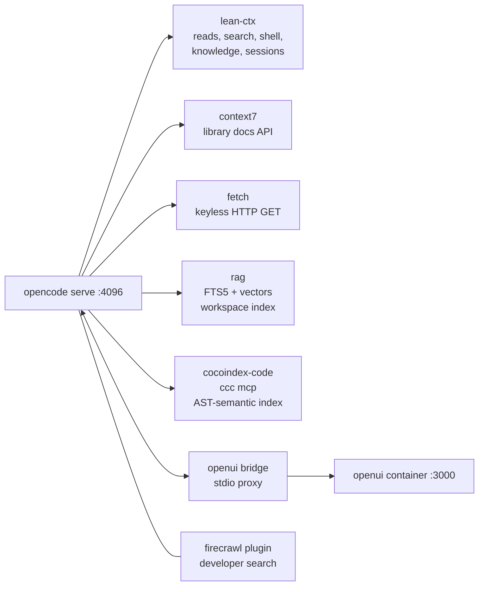
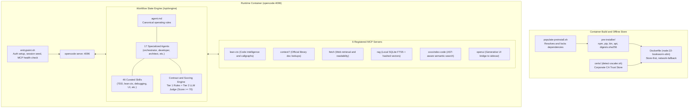
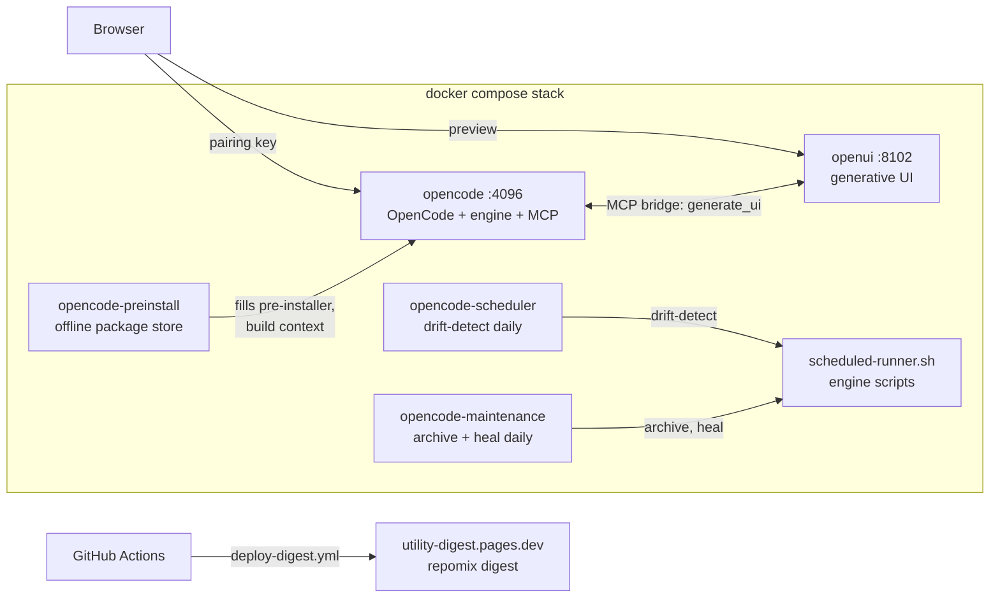

<!-- omit from toc -->
# opencode

Self-hosted OpenCode v2 stack in Docker: workflow-state-engine, lean-ctx, seven MCP servers, offline-ready.

<p>
  
  
  
  
  
</p>

This folder packages OpenCode v2 (`@opencode/cli`, npm `anomalyco/opencode`) as a reproducible Docker stack: the workflow-state-engine (17 agents, 46 skills, contract-driven scoring; counts pinned to `engine/agents/`, `engine/skills/`, and `config/opencode.json`), lean-ctx as the mandatory access layer, and seven MCP servers: lean-ctx, Context7, fetch, rag, OpenUI, CocoIndex Code, and FalkorDB (docker-backed, optional). The image is pre-populated from an offline package store, so builds need no network after the first pull. Versions are resolved once at populate time and recorded in `agents/opencode/pre-install/versions.lock`; that manifest is the lockfile, and an env var such as `OPENCODE_VERSION` is the deliberate pin. OpenCode v2 is early software, so this runs as a **beta experience**. The engine itself is documented in [engine/README.md](engine/README.md).

## Table of Contents

1. [Quick Start](#quick-start)
2. [Configuration](#configuration)
3. [Ports and Volumes](#ports-and-volumes)
4. [Socket Proxy Overlay](#socket-proxy-overlay)
5. [MCP Servers](#mcp-servers)
6. [Health Checks](#health-checks)
7. [Offline Pre-Install Store](#offline-pre-install-store)
8. [Components](#components)
9. [Project Structure](#project-structure)
10. [Architecture](#architecture)
    - [Container Architecture](#container-architecture)
    - [Compose Stack](#compose-stack)
    - [Workflow State Engine](#workflow-state-engine)
    - [Retrieval Topology](#retrieval-topology)
11. [Enforcement and Quality Gates](#enforcement-and-quality-gates)
12. [Troubleshooting](#troubleshooting)
13. [Known Unknowns](#known-unknowns)
14. [Local State](#local-state)
15. [Contributing and License](#contributing-and-license)

## Quick Start

From the repository root:

```bash
cp workspace/agents/opencode/.env.template .env              # fill in your keys
docker compose -f docker-compose.example.yaml --profile tools run --rm opencode-preinstall
docker compose -f docker-compose.example.yaml up -d --build
open http://127.0.0.1:4096                                   # pairing screen, enter your key once
```

The preinstall step fills the workspace-root `pre-installer/` for the host arch; skip it only when the store is already populated. Standalone build and run, without the repository compose file:

```bash
docker build --build-context preinstall=../../pre-installer -t opencode:local .
docker run --rm -it -p 127.0.0.1:4096:4096 \
  -e OPENCODE_API_KEY="<key>" \
  -v "$PWD/config/opencode.json":/home/node/.config/opencode/opencode.json:ro \
  opencode:local
open http://127.0.0.1:4096   # OpenCode's own pairing screen, enter your key once
```

Both the compose stack and the standalone run above publish OpenCode on `127.0.0.1:4096` (loopback only). The first visit shows OpenCode's own pairing prompt; enter the key there. On a shared or production host, route the Docker API through the [socket proxy overlay](#socket-proxy-overlay) instead of the direct socket mount.

The entrypoint boot chain: write `OPENCODE_API_KEY` to `auth.json` and unset it, run the MCP readiness preflight, optionally run engine boot checks, then probe launch forms in order: `opencode serve --hostname 0.0.0.0 --port 4096` → `opencode web --hostname 0.0.0.0 --port 4096` → bare `opencode serve`.

## Configuration

Compose file: [`docker-compose.example.yaml`](../../../docker-compose.example.yaml) at the repository root is the canonical entry point; the sibling [`docker-compose.example.yaml`](docker-compose.example.yaml) in this folder runs the same stack standalone. Both publish OpenCode serve's `4096` on `127.0.0.1:4096` (loopback only).

### Runtime environment

| Variable | Required | Default | Description |
|---|---|---|---|
| `OPENCODE_API_KEY` | Yes | `REPLACE_ME` | OpenCode auth + opencode model gateway (reviewer tier); written to `auth.json`, then unset from the env |
| `OPENCODE_SERVER_PASSWORD` | No | (empty) | Auth key for OpenCode's own HTTP basic auth / pairing screen |
| `SUMOPOD_API_KEY` | Yes | (empty) | Primary provider key. Executor tier runs `glm-5.3-flash`; light tier + fallback `hy4-flash` |
| `SUMOPOD_BASE_URL` | No | `https://ai.sumopod.com/v1` | Primary provider endpoint |
| `SUMOPOD_BASE_MODEL` | No | `glm-5.3-flash` | Primary executor model id |
| `SUMOPOD_BASE_MODEL_NAME` | No | `glm-5.3-flash` | Primary model display name |
| `CONTEXT7_API_KEY` | Yes | `REPLACE_ME` | Context7 docs MCP key |
| `FIRECRAWL_API_KEY` | No | (unset) | Firecrawl key; developer search works keyless, alexandria + firecrawl-cli skills need it |
| `RAG_EMBEDDINGS_URL` | No | (empty) | OpenAI-compatible `/v1/embeddings` endpoint for the rag server; all three `RAG_EMBEDDINGS_*` set switches it to remote embeddings |
| `RAG_EMBEDDINGS_MODEL` | No | (empty) | Embeddings model id at the endpoint above |
| `RAG_EMBEDDINGS_KEY` | No | (empty) | Bearer key for the embeddings endpoint |
| `OPENCODE_AUTH_REQUIRED` | No | `true` | Fail boot when `OPENCODE_API_KEY` is missing |
| `OPENCODE_CONFIG` | No | `/home/node/.config/opencode/opencode.json` | Config path inside the container |
| `MCP_CHECK_ENABLED` | No | `true` | Boot-time MCP readiness preflight |
| `MCP_CHECK_TIMEOUT` | No | `20` | Per-server probe timeout (seconds) |
| `MCP_CHECK_STRICT` | No | `false` | Exit 1 when a server is not ready |
| `ENGINE_BOOT_CHECK` | No | `false` | Validate the bundled engine before launch |
| `ENGINE_BOOT_STRICT` | No | `false` | Exit 1 when a boot check fails |
| `ENGINE_BOOT_TIMEOUT` | No | `30` | Per-check timeout (seconds) |

### Build args

| Arg | Required | Default | Description |
|---|---|---|---|
| `OPENCODE_ARCH` | No | auto (`TARGETARCH`, `arm64` fallback) | Platform package (`@opencode/cli-linux-${OPENCODE_ARCH}`); x64 builds override or rely on `TARGETARCH` |
| `OPENCODE_VERSION` | No | empty (store) | OpenCode CLI pin; empty means the store's `versions.lock` entry |
| `LEAN_CTX_VERSION` | No | empty (store) | lean-ctx pin; empty means the store's entry |
| `CONTEXT7_VERSION` | No | empty (store) | `@upstash/context7-mcp` pin; empty means the store's entry |
| `MCP_VERSION` | No | empty (store) | MCP Python SDK pin; empty means the store's entry |
| `MCP_SERVER_FETCH_VERSION` | No | empty (store) | `mcp-server-fetch` pin; empty means the store's entry |
| `ZOD_VERSION` | No | empty (store) | zod pin (runtime dep of `@firecrawl/opencode`, resolved once) |
| `FIRECRAWL_CLI_VERSION` | No | empty (store) | `firecrawl-cli` pin (binary `firecrawl`) |

Version resolution happens at populate time, not at build: `populate-preinstall.sh` asks the registry for the current version of each package, writes the result to `agents/opencode/pre-install/versions.lock`, and the Dockerfile consumes the store globs. A resolver failure warns and falls back to the previous pin. To pin deliberately, pass the env var (for example `OPENCODE_VERSION: "2.3.0"` in the compose build args).

Config files: `config/opencode.json` (V2-native schema: `agents`, `permissions` (incl. a `firecrawl_alexandria` ask entry), `plugins` (vendored `/opt/engine/plugins/opencode-firecrawl`), `mcp.servers` + `disabled`, `providers.package`, `instructions` (loads `/opt/engine/agent.md` plus `opencode/config/rag-usage.md`, which tells agents to search the rag index before writing code), `update`, `compaction.keep.tokens`; mounted read-only).

## Model Policy

| Tier | Model | Notes |
|---|---|---|
| Primary + executor (build, orchestrator, system-analyst, developer, fixer, all default agents) | sumopod/glm-5.3-flash | Live provider; set SUMOPOD_API_KEY; 1M ctx |
| Light tier (explorer, librarian, explore subagent) + executor fallback | sumopod/hy4-flash | Fast short-loop lookups; 24x cheaper cache reads make cached agent sessions roughly half the blended cost of glm |
| Reviewers (quality-analyst, security-engineer, software-architect, tier-2 judge) | opencode/deepseek-v4.1-flash-free | Different model family than the GLM executor (genuine cross-model); opencode gateway, no extra key |

If a reviewer can only run on the same provider family as the executor after fallback, set governance.cross_model_degraded=true and cap the combined verdict at RETRY (engine/rules/rules.json, enforcement.cross_model_review.degraded_mode). Model availability verified against the live sumopod and opencode gateway registries.

## Security Notes

- docker.sock is mounted into the opencode container (compose group_add DOCKER_GID). That is host-equivalent access, needed for sandbox container management. Treat container compromise as host compromise; prefer the [socket proxy overlay](#socket-proxy-overlay) in hostile environments.
- Set OPENCODE_SERVER_PASSWORD in production, or bind the service to localhost. The empty default leaves the server unauthenticated on its port.
- Gate scripts (validate-contract, state-guard, sdd-gate, snapshot-contract, persist-contract, loop-validate, verify-knowledge, auto-score, detect-parallel-conflicts) are allowlisted in config/lean-ctx-config.toml with per-entry rationale; extend with lean-ctx allow, never by hand-editing the runtime file.
- The sidecar openui service still defaults to the sumopod provider for its own model calls; it needs the same live-provider treatment as the main config (tracked as follow-up).
- Artifact integrity (S3): populate-preinstall.sh enforces sha256 digests from pre-install/digests.sha256 on EVERY populate run: pin-count fail-closed (a comments-only manifest fails when the store is non-empty), mismatch quarantines the artifact (moved to .quarantine, invisible to the Dockerfile globs), verify mode reverse-sweeps for unpinned store files, and the run ends with a re-verification of pinned artifacts. The FIRST fetch of a new artifact is trust-on-first-use (TOFU): its digest is recorded at fetch time by --update-digests and enforced from the next run - name that window when reviewing store changes. Maintainers record with: sh populate-preinstall.sh --update-digests. The store build (--verify-digests in the Dockerfile) fails on any mismatch, missing pin, or unpinned artifact once the manifest has entries.
- Deployment modes (S5): OPENCODE_DEPLOY_MODE=production makes the entrypoint fail fast unless OPENCODE_SERVER_PASSWORD is set or OPENCODE_BIND_LOCALHOST=1 is explicit; BIND_LOCALHOST=1 actually binds the serve/listen host to loopback (the entrypoint BIND_HOST path), not just documents it. Default dev mode keeps current behavior.
- Socket confinement (S1): opt-in via docker-compose.socket-proxy.yaml (full guide: [Socket Proxy Overlay](#socket-proxy-overlay)) - a blast-radius REDUCER, not a security boundary: the proxy gates the API surface (no EXEC/VOLUMES, PING/VERSION read-only) but a determined container escape is out of scope for it. Host socket mount dropped with the !override volumes tag (compose v2.24+). The proxy healthcheck tolerates nothing less than a 200 on /_ping; the opencode healthcheck answers 200 unauthenticated or 401 under basic auth and only 5xx is failure.

## Ports and Volumes

| Host | Container | Notes |
|---|---|---|
| `127.0.0.1:4096` | `4096` | OpenCode web UI (serve); loopback only |
| `./workspace` | `/home/node/workspace` | Working tree mounted into the container (repo compose) |
| `config/opencode.json` | `/home/node/.config/opencode/opencode.json` | Read-only bind mount; restart to apply edits |
| `opencode-data` (named volume) | `/home/node/.local/share/opencode` | Auth, session store, lean-ctx knowledge store, rag index |
| `../../pre-installer/` (workspace root) | build context `preinstall` | Offline package store, consumed at build time |

## Socket Proxy Overlay

`docker-compose.socket-proxy.yaml` (repository root) is an opt-in compose overlay that puts the Docker API behind [tecnativa/docker-socket-proxy](https://github.com/Tecnativa/docker-socket-proxy) instead of handing opencode the host socket directly. opencode holds the raw `/var/run/docker.sock` mount today; the overlay replaces that mount with a filtered TCP endpoint (`DOCKER_HOST=tcp://docker-socket-proxy:2375`).

**When to use it.** Production and shared-host deployments, where anything reaching the opencode container could otherwise talk to the full Docker API; multi-service stacks that want least privilege on the socket. Not needed for single-user development on a trusted machine: skip it there and keep the base compose file.

**Why.** Blast-radius reduction. The shipped default profile is observational/read-only: `POST: 0`, `ALLOW_RESTARTS: 0`, `EXEC: 0`, `VOLUMES: 0` leave the API read-only (`docker ps`, `images`, `inspect`; events, ping, and version handshakes stay enabled). The common escape routes are the exec API and the volume API (new host bind mounts over the socket), and both stay denied. The create-capable opt-in (`POST: 1`) is documented in the overlay header as host-root-equivalent: a created container can be privileged or bind host paths, so opt in only where the opencode container is already trusted with that power.

**How to activate.** Pin the image by digest first (the overlay header documents the `docker manifest inspect` commands to obtain it; no digest is invented in the repo):

```bash
DOCKER_SOCKET_PROXY_IMAGE=tecnativa/docker-socket-proxy@sha256:<digest> \
docker compose -f docker-compose.example.yaml -f docker-compose.socket-proxy.yaml up -d
```

Compose v2.24+ is required for the `!override` volumes tag that drops the direct socket mount. The proxy runs its own healthcheck on `/_ping`, and opencode `depends_on` it with `condition: service_healthy`, so the stack only starts once the filtered API answers. The proxy sits on a dedicated internal network, off the shared default net.

**What breaks if you skip it.** Nothing: it is opt-in, and the base compose keeps the direct mount.

**Honest boundary.** This is a blast-radius reducer, NOT an escape boundary. A determined container escape is out of scope for it. Threat models that assume an attacker inside opencode should still treat container compromise as host compromise.

## MCP Servers

Seven servers are defined in `config/opencode.json`; every baked server must answer the boot preflight or the container fails to start.

| Server | Command | Purpose |
|---|---|---|
| `lean-ctx` | `lean-ctx` | Compressed reads/search/shell, code intelligence, knowledge and session persistence |
| `context7` | `context7-mcp` | Up-to-date library docs lookups; needs `CONTEXT7_API_KEY` |
| `fetch` | `mcp-server-fetch` | Keyless single-page HTTP GET with readability extraction (deps baked at build) |
| `rag` | `node /opt/rag/server.js` | Workspace retrieval over SQLite FTS5 + vectors: `rag_search`, `rag_index`, `rag_status`, `rag_get`; java-aware method-boundary chunking with `package > class > method` headings; offline hashed-vector embeddings, optional remote endpoint via `RAG_EMBEDDINGS_*`; agents get usage rules from the `opencode/config/rag-usage.md` instructions entry |
| `cocoindex-code` | `ccc mcp` | AST-semantic code search across the workspace (`ccc` CLI, cocoindex-code MCP); complements lean-ctx, and is not a symbol/callgraph replacement. The wheel is baked into the image and the Dockerfile fails the build without it |
| `openui` | `node /home/node/workspace/agents/openui/mcp-bridge.mjs` | Stdio bridge to the openui container (`OPENUI_URL=http://openui:3000`): `generate_ui`, `preview_url` |
| `falkordb` | `docker run -i --rm --network kg-net ... falkordb/mcpserver:latest` | Governance fact graph over FalkorDB (OpenCypher): `query_graph`, graph create/delete, schema listing. Setup in [ai/mcp/falkordb/](ai/mcp/falkordb/README.md) (`kg-up.sh` pulls images, starts the DB, data under `/home/node/workspace/kg-data`); warn-only at boot until the DB runs |

`@firecrawl/opencode` ships as a **plugin**, not an MCP server (FalkorDB holds the seventh MCP seat): vendored at `engine/plugins/opencode-firecrawl`, keyless `firecrawl_developer_search`, ask-gated `firecrawl_alexandria`, keyed scrape/crawl through `firecrawl-cli`.

The image ships no demo MCP servers: everything installed is registered in `config/opencode.json`; to add a server, install it, register it there, and restart.

MCP wiring:



## Health Checks

Run from this folder (`workspace/agents/opencode`); every script exits 0 on a healthy tree:

```bash
bash engine/scripts/health-check.sh             # aggregates the full suite (6 dimensions)
bash engine/scripts/check-cross-references.sh   # link/ID integrity across engine docs
bash engine/scripts/validate-toolkit.sh         # symlinks, contract integrity, agent consistency
bash engine/scripts/check-conventions.sh        # architecture conventions (non-blocking)
bash engine/scripts/check-doc-style.sh          # doc style gate: dashes, vocabulary, placeholders
bash engine/scripts/check-plugins.sh            # V2 plugin path rule (no file:// to file)
bash engine/scripts/check-mcp.sh                # MCP server binaries present
bash engine/scripts/boot/engine-check.sh        # boot-time engine validation
bash engine/scripts/boot/mcp-check.sh           # boot-time MCP readiness probe
```

Details: [engine/doc/health-check.md](engine/doc/health-check.md).

## Offline Pre-Install Store

The workspace-root `pre-installer/` store holds apt `.deb` files, pip wheels, npm tarballs, git sources, and prebuilt binaries for the host arch: populate reads `uname -m` (`x86_64` to `x64`, `aarch64` to `arm64`) and prunes the other one. The compose `opencode-preinstall` service (profile `tools`) is a throwaway `node:22-bookworm-slim` container that fills it; repeat runs skip everything already present and prune stale copies. The image build consumes the store via the `preinstall` build context; without it, installs fall back to the network and fail in offline environments. The store is gitignored by design; `versions.lock`, `digests.sha256` and `packages-apt.txt` are tracked. The apt tier is offline-first: `packages-apt.txt` is the single source of truth (13 base packages), `apt-closure.sh` expands it to the recursive dependency closure (virtuals and OR-alternatives resolved by apt's own solver, whose unpack/configure schedule lands in `store/apt/install-order.txt`), and `REFRESH_APT=1` forces a re-fetch. At build time `apt-install.sh` replays that schedule with `dpkg --unpack` and `dpkg --configure` - Pre-Depends need the prerequisite configured at unpack time, so configure checkpoints sit between unpacks - (OFFLINE tier), falling back to `apt-get` only when the store is absent, partial, wrong-arch or a dpkg run fails - every fallback logs loudly. First-fetch debs carry the usual TOFU window until `--update-digests` records pins. Maintainer verification: `docker build --network none -f workspace/agents/opencode/Dockerfile --build-context preinstall=workspace/pre-installer workspace/agents/opencode` (requires a populated, pin-verified store; the build fails closed otherwise). The root [README](../../../README.md) covers auto-latest resolution, `versions.lock`, and the ML closure (`REFRESH_ML=1`).

## Components

| Component | Source |
|---|---|
| OpenCode v2 CLI + platform pkg | npm (`anomalyco/opencode`), resolved at populate |
| lean-ctx | [GitHub release](https://github.com/yvgude/lean-ctx), resolved at populate |
| Context7 MCP | npm, `@upstash/context7-mcp` |
| Fetch MCP | PyPI, `mcp-server-fetch` (with the MCP Python SDK) |
| rag | in-tree at [rag/](rag/), zero npm dependencies, `node /opt/rag/server.js` |
| CocoIndex Code | PyPI wheel, `ccc` CLI, registered as `cocoindex-code` |
| OpenUI | in-tree bridge [mcp-bridge.mjs](../../openui/mcp-bridge.mjs) to the openui sidecar |
| @firecrawl/opencode | `1.4.0` (ISC, first-party), vendored at `engine/plugins/opencode-firecrawl` ([upstream](https://github.com/firecrawl/opencode-firecrawl)) |
| firecrawl-cli | npm, binary `firecrawl` |

Every version above lands in `agents/opencode/pre-install/versions.lock` when populate runs; that file is the pin record. There is no separate version list to keep in sync.

**Custom plugins removed** (`@razroo/opencode-model-fallback@0.3.2`, `@tarquinen/opencode-dcp@3.2.0`, `opencode-websearch-cited@1.2.0`): they target the V1 plugin API and V2 additionally rejects their old `file://<file>` entries (`configured plugin path must be a directory`), so they never loaded. They are dropped from the image and `config/opencode.json` until ported to the `@opencode/plugin` V2 API; provider failover is carried by the provider config (sumopod primary; the reviewer tier rides the built-in opencode gateway) plus rules.json degraded_mode. Contrast: the first-party V2-native `@firecrawl/opencode` plugin is adopted offline-vendored at `engine/plugins/opencode-firecrawl` (developer search works keyless out of the box); the community V1-era plugins above remain removed.

## Project Structure

```text
opencode/
├── Dockerfile                   # Image build; consumes the preinstall context
├── entrypoint.sh                # Boot chain: auth -> MCP preflight -> serve
├── docker-compose.example.yaml  # opencode + preinstall + scheduler services
├── rag/                         # RAG MCP server (zero npm dependencies)
│   ├── server.js                # CLI + MCP stdio; SQLite FTS5 + vectors
│   ├── README.md
│   ├── test.sh                  # 10-case suite (CLI, Java chunking, MCP, remote embeddings)
│   └── test/                    # corpus fixtures, embeddings stub, MCP checks
├── populate-preinstall.sh       # Offline-store bootstrap (fills workspace-root pre-installer/)
├── .env.template                # Copy to repository-root .env
├── config/                      # opencode.json (V2-native, 6 MCP servers), rag-usage.md agent guidance, lean-ctx-config.toml (baked gate-script allowlist)
├── certs/                       # TLS certs mirror (synced from workspace-root certs/)
├── pre-install/                 # versions.lock + .gitkeep only (store at workspace-root pre-installer/)
├── session/                     # Live orchestration contract + state log (gitignored)
├── sandbox/                     # Session playground, one folder per session (contents gitignored)
└── engine/                      # Workflow-state-engine -> copied to /opt/engine
    ├── agent.md                 # Orchestrator instructions (instructions[0])
    ├── agents/                  # 17 agent instruction files
    ├── skills/                  # 46 skill directories
    ├── commands/                # 1 slash command (impeccable)
    ├── rules/                   # rules.json + rules.schema.json
    ├── contract/                # Contract templates + JSON Schema
    ├── scripts/                 # Automation & validation scripts (incl. boot/)
    ├── usage/                   # 3 tool guides (lean-ctx, context7, opencode)
    ├── doc/                     # Workflow + health-check docs
    ├── templates/               # judge-prompt.md
    └── opencode.json.template   # Config template (V2-native shape, same 6 MCP servers)
```

CI lives at the repository root: [.github/workflows/validate.yml](../../../.github/workflows/validate.yml) runs JSON validity, a `bash -n` sweep, cross-reference and doc style gates, and contract scoring on every push.

## Architecture

Diagrams follow one standard: Mermaid blocks inside markdown, one diagram per concept, no binary images. This section documents the internal container build and runtime architecture, compose stack relationships, Workflow State Engine, and retrieval topology.

### Container Architecture

The container builds offline-first from the pre-install store and boots into a governed runtime:



### Compose Stack



| Container | Role |
|---|---|
| `opencode` | The product: OpenCode serve, Workflow State Engine (17 agents, 46 skills), lean-ctx, and six MCP servers |
| `openui` | Generative UI sidecar: agents connect through the MCP bridge, preview on `:8102` |
| `opencode-scheduler` | Daily maintenance: runs drift detection between persisted engine state and workspace files |
| `opencode-maintenance` | Daily maintenance: runs session snapshot cleanup and self-healing validation |
| `opencode-preinstall` | Build helper: populates the offline package store used as Docker build context |

```text
Host browser -> 127.0.0.1:4096 (loopback, published) -> opencode serve :4096

entrypoint.sh boot chain:
  1. auth: OPENCODE_API_KEY to auth.json, then unset
  2. MCP preflight: JSON-RPC initialize per enabled local server
  3. engine boot checks: validate-contract --score, check-plugins
  4. launch probe: serve, then web, then bare serve

opencode serve attaches to:
  - MCP servers: lean-ctx, context7, fetch, rag, cocoindex-code, openui bridge
  - Firecrawl plugin: keyless developer search, alexandria ask-gated
  - workflow-state-engine: 17 agents, 46 skills, session/, sandbox/
```

### Workflow State Engine

The engine at `engine/` manages agent coordination through contract gates and formal roles:

- **State machine lifecycle**: Tasks move through sequential states: `INIT` -> `PLAN` -> `PLAN_SCORED` -> `EXECUTE` -> `EXECUTE_SCORED` -> `REVIEW` -> `REVIEW_SCORED` -> `COMPLETE`. If blockers occur, the state switches to `BLOCKED`.
- **Scoring pipeline**: Transitions require a composite score of 70 or higher:
  $$\text{Score} = \frac{\text{Tier 1 Rules Subtotal} + \text{Tier 2 Judge Score}}{2}$$
  - *Tier 1 (Rules)*: Starts at 100 points with deterministic deductions (-40 for permission violations, -40 for unacknowledged high blast radius, -15 for schema errors, -15 for writing order violations, -15 for missing required fields).
  - *Tier 2 (Judge)*: Evaluates requirements fulfillment (40%), governance compliance (30%), completeness (20%), and edge cases (10%).
  - *Verdicts*: Score >= 70 passes; 50 to 69 triggers retry with feedback (up to 3 attempts); below 50 blocks.
- **17 Agent Personas** ([`engine/agents/`](engine/agents)):
  - *Entry and Coordination*: `build` (restricted bootstrap triage), `orchestrator` (primary coordinator and task planner), `design-orchestrator` (UI and UX design lead).
  - *Analysis and Planning*: `product-manager` (requirements and acceptance criteria), `system-analyst` (specifications and impact analysis), `software-architect` (architecture design and trade-offs).
  - *Implementation*: `developer` (plan execution and coding), `fixer` (bounded quick patches), `devops-engineer` (CI/CD, containers, infrastructure).
  - *Quality, Security and Consensus*: `quality-analyst` (code quality and test verification), `security-engineer` (threat modeling and security reviews), `scrum-master` (process and state machine guard), `council` (multi-model consensus for high-stakes decisions).
  - *Research and Memory*: `explorer` (codebase discovery), `librarian` (external documentation), `observer` (visuals and diagrams), `learner` (post-task pattern capture).
- **46 Curated Skills** ([`engine/skills/`](engine/skills)):
  - *Engineering discipline*: `test-driven-development`, `systematic-debugging`, `spec-driven-development`, `simplify`, `doubt-driven-development`, `java-developer`, `software-developer`.
  - *Context and efficiency*: `lean-ctx`, `token-optimize`, `tool-economy`, `context-standards`.
  - *Design and user interface*: `diagram-design`, `drawio-animation`, `banner-design`, `ui-styling`, `ui-ux-pro-max`, `impeccable`, `slides`.
  - *Quality and process*: `code-review-and-quality`, `security-expert`, `verification-before-completion`, `audit-observability`, `observability-and-instrumentation`, `shipping-and-launch`, `release-plan`, `humanizer`.

### Retrieval Topology

Different questions route to specific search layers ([`docs/semantic-index-routing.md`](docs/semantic-index-routing.md)):

| Layer | Tool | Scope | Purpose |
|---|---|---|---|
| `lean-ctx` | `ctx_search`, `ctx_callgraph` | AST code graph | Exact symbol definitions, caller hierarchies, and blast radius |
| `cocoindex-code` | `ccc search` | Git repository | AST-aware semantic code search across indexed repositories |
| `rag` | `rag_search` | Workspace tree | Hybrid FTS5 BM25 and 256-bucket hashed vector search across docs and sessions |
| `context7` | `context7-mcp` | External libraries | Real-time upstream library documentation lookups |
| `fetch` | `mcp-server-fetch` | Web pages | Keyless single-page HTTP retrieval with Readability.js cleanup |
| `openui` | `generate_ui` | Sidecar service | Generative UI and interactive preview components |

On every push, GitHub Actions validates the tree (JSON, shell syntax, cross-references, doc style, contract score) and repacks `workspace/agents/opencode/**` for agent consumption on Cloudflare Pages.


## Enforcement and Quality Gates

| Gate | Checks | Wired into |
|---|---|---|
| `engine/scripts/check-cross-references.sh` | 8-check link/ID integrity + context-standards + access-policy verification | `health-check.sh` lens-4, `validate-toolkit.sh`, pre-commit hook, CI |
| `engine/scripts/check-doc-style.sh` | Doc style gate: em/en dashes, AI vocabulary, placeholders in shipped docs | `health-check.sh --check docs`, `validate-toolkit.sh`, pre-commit hook, CI |
| `engine/scripts/check-plugins.sh` | Rejects `file://`-to-file plugin paths (V2 rule) | `setup.sh`, `validate-toolkit.sh`, engine boot checks |
| `engine/scripts/validate-contract.sh --score` | 3-tier contract scoring (PASS >= 70) | CI, engine boot checks |
| `engine/scripts/check-conventions.sh` | Rule 1 FAILs stale contract paths; INFOs the V2 chain | `validate-toolkit.sh`, CI (non-blocking) |
| `engine/rules/rules.schema.json` | `store_in` target schema + required top-level keys for rules | `validate-toolkit.sh` |
| `engine/.githooks/pre-commit` | `bash -n` sweep + cross-references + doc style | `git config core.hooksPath engine/.githooks` |
| `.github/workflows/validate.yml` (repository root) | JSON validity, `bash -n`, cross-refs, doc style, contract score, conventions | Runs on every push and pull request |
| humanizer gate (`/skill humanizer`) | Strips AI writing patterns (em dashes, rule-of-three, promotional tone) from shipped user-facing docs; internal state files (`session/state.md`, contract JSON, code comments) exempt | `agent.md` ship flow, `engine/skills/release-plan`, `engine/skills/shipping-and-launch` |
| context gate (`/skill context-standards`) | Loads target-project pattern standards (`context/*.md`) before edits and verifies them in review | `agent.md` Execute step, `developer.md`, `quality-analyst.md`, cross-reference check 7 |
| `engine/scripts/loop-validate.sh` | In-loop executor done-gate: JSON parse, `bash -n` sweep, cross-references; mirrors CI locally | developer / fixer / system-analyst rule 7, orchestrator scoring table (Tier 1) |
| Agent permission tiers (`config/opencode.json`) | Read-only agents deny edit, shell, webfetch, question; global edit-deny on `**/opencode.json` and `**/contract.json` | OpenCode permission checks on every tool call |
| Sandbox policy (`rules.json -> enforcement.sandbox`) | Scratch work confined to `sandbox/<session-slug>/`; own folder only, root never written, contents gitignored, promote before COMPLETE | `engine/agent.md` section 6, writer agents' Permissions blocks, `sandbox/README.md` |
| lean-ctx shell allowlist (`config/lean-ctx-config.toml`) | Baked allowlist (`shell_allowlist_extra`) gates which binaries agents may run; `lean-ctx allow <cmd>` extends it | Copied to `/home/node/.config/lean-ctx/config.toml` at build |

## Troubleshooting

| Symptom | Cause | Fix |
|---|---|---|
| Build fails fetching from GitHub behind the corporate proxy | The proxy re-signs TLS with a root the image does not trust | Drop your CA `.crt` into the workspace-root `certs/` and run `sh certs/sync-certs.sh`, re-run the preinstall service, rebuild. `certs/detect-zscaler.sh` also refreshes auto-detected roots on every populate run |
| `EBADPLATFORM`, or a missing platform package on x64 | The store held arm64 tarballs; arch now follows `TARGETARCH` at build and `uname -m` at populate | One preinstall run self-heals the store (it prunes the other arch); then rebuild |
| Store stays on an old package version | The store is the lockfile, so a rebuild alone never moves a version | Re-run the preinstall service: a skip-path prune removes stale copies and a changed version is fetched. The ML closure refreshes only with `REFRESH_ML=1` |
| An agent cannot run a binary (for example `opencode` or `ccc`) | lean-ctx's baked allowlist does not include it | Add the bare name to `shell_allowlist_extra` in `config/lean-ctx-config.toml` and rebuild, or run `lean-ctx allow <cmd>` inside the container |
| Forgot the key | OpenCode's pairing screen expects `OPENCODE_SERVER_PASSWORD` from the repository root `.env` | Run `grep OPENCODE_SERVER_PASSWORD .env` from the repository root; change it there and restart the `opencode` service |
| Web UI unreachable, port already allocated | Host port 4096 is taken by another process | Change the host side of the `ports:` mapping in the compose file |
| Config edits have no effect | `config/opencode.json` is mounted read-only | Restart the container after editing; the mount itself never changes |
| `fetch` MCP fails to extract pages | Image predates the baked readabilipy dependencies; older builds installed them per request and needed network | Rebuild from this Dockerfile; the readability node modules are baked in |
| Session state lost between restarts | Orchestration state lives in `session/` plus the lean-ctx knowledge store and rag index inside the `opencode-data` volume | Removing the volume removes the knowledge store, session store, and rag index; `session/contract.json` lives in the mounted workspace, so inspect both before wiping |
| `rag_search` returns nothing | The index is empty or the server reads a different database than expected | Run `rag_index` (or `node /opt/rag/server.js index`), then check `rag_status`: it prints the db path, the indexed root, and a stale file count; make sure `RAG_DB` matches the path you expect |
| rag embedding mode looks wrong | An index keeps the embedding mode it was built with; `rag_search` uses that mode, and switching `RAG_EMBEDDINGS_*` only takes hold on the next `rag_index` | Re-run `rag_index` after changing the env; `rag_status` prints `embedding_mode` and `dims` |

## Known Unknowns

- **V2 config schema** (resolved as of 2026-11-01): `config/opencode.json` migrated to the V2-native shape; deprecated keys (`agent`, `permission`, `mcp.<name>`, `autoupdate`, `compaction.reserved`, `bash`) must not be reintroduced.
- **Plugin API**: the three custom plugins were removed (see [Components](#components)); port them to `@opencode/plugin@2.x` before re-adding.
- **`opencode web` flags**: v2 CLI subcommands are not fully verified. `entrypoint.sh` probes at boot: `opencode serve --hostname ... --port ...` -> fallback `opencode web --hostname ... --port ...` -> fallback bare `opencode serve`.

## Local State

Never committed or pushed:

- `pre-installer/` (workspace root): offline package store (gitignored by design), with `pre-install/versions.lock` (tracked) as the version manifest.
- `session/`: **project-local runtime state**. Compose mounts the workspace at `/home/node/workspace`, so this `session/` *is* the container's global session directory: `contract.json` (seeded from `engine/contract/contract.template.json` via `snapshot-contract.sh`), `state.md`, `state.example.md` (tracked), `archive/`. Gitignore policy: `session/*` ignored, `state.example.md` negated.
- `sandbox/`: **session playground**. One folder per live session (`sandbox/<session-slug>/`) for probes, clones, and rendered tests. Tracked: `README.md`, `.gitignore`, `.gitkeep`; everything else is gitignored on the `certs/` pattern. Rules: [sandbox/README.md](../../../sandbox/README.md).

The engine reference ([engine/README.md](engine/README.md)) covers internals.

## Contributing and License

The stack is internal and not open for external contribution. Changes are made in place; the CI workflow at the repository root and a PR template ([.github/PULL_REQUEST_TEMPLATE.md](../../../.github/PULL_REQUEST_TEMPLATE.md)) apply the usual gates automatically. For local commits, enable the pre-commit hook with `git config core.hooksPath engine/.githooks`. No license file ships with this repository.
