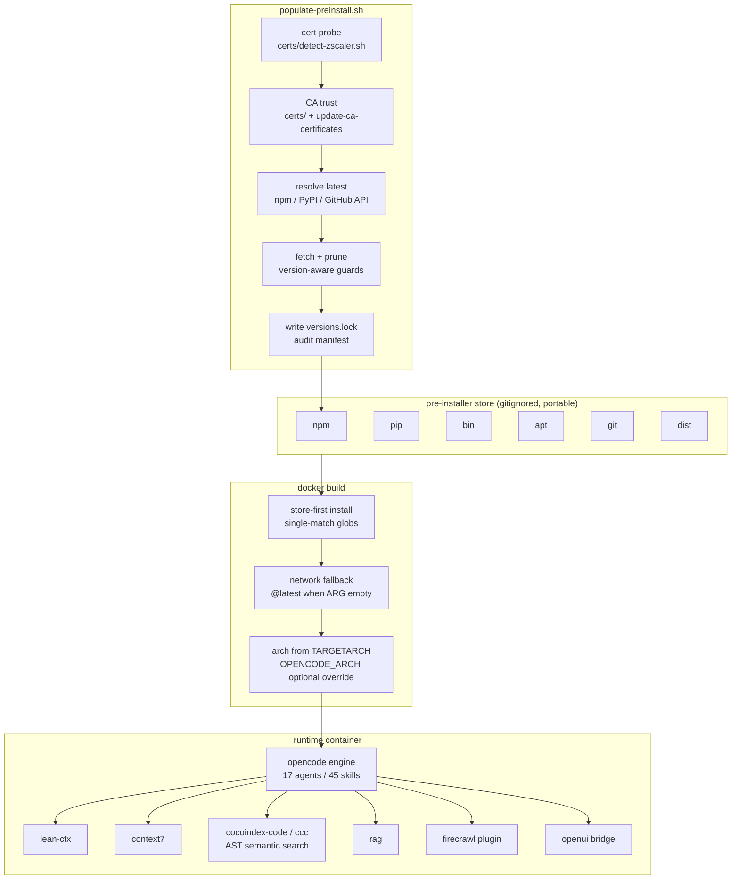
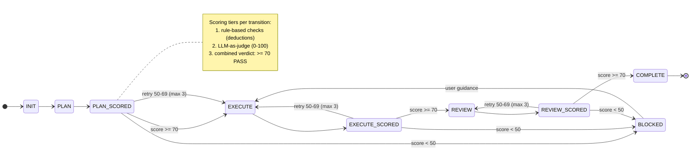

<!-- omit from toc -->
# Opencode Workflow

Two views of the stack: how the offline package store becomes a running container, and how a task moves through the gated orchestration state machine. Gitea renders both Mermaid blocks inline.

## Build to runtime

The offline store is the lockfile: populate-preinstall resolves the latest versions at populate time, fetches them, prunes older copies, and records the result in `versions.lock`. Re-running populate is the update-everything action; between populate runs, builds stay frozen at whichever snapshot the store holds.

## Orchestration workflow

Every transition carries a score: rule checks first, then an LLM judge, then a combined verdict. 70 or above passes, 50 to 69 retries with feedback, below 50 (or three exhausted retries) blocks.

