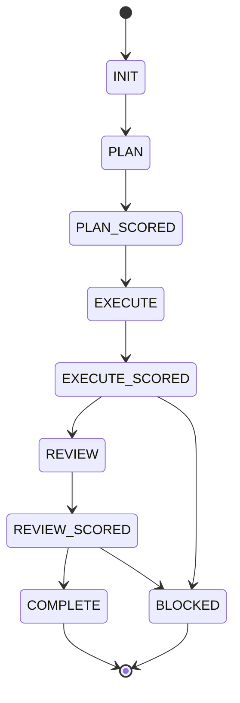

<!-- omit from toc -->
<a id="readme-top"></a>
# Workflow State Engine

Contract-driven state machine orchestration engine for AI agent workflows: 16 agents, 66 skills, gated scoring on every delegation.


Single source of truth for all AI agents. The canonical agent instruction file is [`agent.md`](agent.md), which is `instructions[0]` for every agent. The engine ships inside the container image (`engine/` copied to `/opt/engine/` and symlinked into the OpenCode config directory).

<p align="right">(<a href="#readme-top">back to top</a>)</p>

## Table of Contents

1. [About The Engine](#about-the-engine)
   - [Built With](#built-with)
2. [Quick Start](#quick-start)
3. [Getting Started](#getting-started)
   - [Prerequisites](#prerequisites)
   - [Build](#build)
   - [Configure](#configure)
   - [Run](#run)
   - [Verify](#verify)
4. [State Machine](#state-machine)
5. [Scoring Pipeline](#scoring-pipeline)
6. [Agents](#agents)
7. [Scripts](#scripts)
8. [Architecture](#architecture)
9. [Workflow](#workflow)
10. [Where State Lives](#where-state-lives)
11. [Roadmap](#roadmap)
12. [FAQ](#faq)
13. [Troubleshooting](#troubleshooting)
14. [Contributing](#contributing)
15. [License](#license)
16. [Acknowledgments](#acknowledgments)

<p align="right">(<a href="#readme-top">back to top</a>)</p>

## About The Engine

This is a reusable orchestration toolkit for AI coding agents. It codifies agent collaboration into a gated state machine (8 forward-flow states + BLOCKED escalation) that ensures:

- **Every output is scored** via a three-tier pipeline (rule checks → LLM-as-judge → combined verdict)
- **Every decision is tracked** in the shared JSON envelope (`session/contract.json`)
- **Every session learns** from the last: lessons and patterns persist cross-session via `lean-ctx ctx_knowledge`
- **Every delegation is gated**: agents only transition if scoring thresholds are met

Reference docs beyond this README:

| Resource | Content |
|---|---|
| [`doc/workflow.md`](doc/workflow.md) + [`doc/workflow/`](doc/workflow/README.md) | Canonical state machine, gates, validation rules (5 parts) |
| [`doc/health-check.md`](doc/health-check.md) | Health check dimensions and wiring |
| [`doc/project.md`](doc/project.md) | Project vision, scope, constraints |
| [`doc/service-rules-thresholds.md`](doc/service-rules-thresholds.md) | Service rules and thresholds |
| [`doc/skill-conventions.md`](doc/skill-conventions.md) | Skill packaging conventions |
| [`contract/README.md`](contract/README.md) | Envelope schema reference |
| [`usage/lean-ctx.md`](usage/lean-ctx.md), [`usage/graphify.md`](usage/graphify.md), [`usage/context7.md`](usage/context7.md), [`usage/opencode.md`](usage/opencode.md) | Tool usage guides |
| [`rules/rules.json`](rules/rules.json) | State machine transitions, scoring thresholds, cross-model review |

### Built With

This project is a documentation and configuration toolkit for AI agents. It uses:

- [OpenCode](https://www.npmjs.com/package/@opencode/cli): AI agent platform (`@opencode/cli`, npm `anomalyco/opencode`)
- [lean-ctx](https://github.com/yvgude/lean-ctx): compressed context management + code intelligence
- [Graphify](https://pypi.org/project/graphifyy/): knowledge graph builder (`graphifyy[mcp]`, PyPI)

<p align="right">(<a href="#readme-top">back to top</a>)</p>

## Quick Start

Engine-level tasks: run the check suite from the project root (`workspace/agents/opencode`):

```bash
bash engine/scripts/health-check.sh             # full suite, 6 dimensions
bash engine/scripts/check-cross-references.sh   # link/ID integrity
bash engine/scripts/check-doc-style.sh          # doc style gate
bash engine/scripts/validate-toolkit.sh         # toolkit integrity
bash engine/scripts/validate-contract.sh --file engine/contract/contract.template.json --score
```

Inside a running container the same scripts live at `/opt/engine/scripts/`. Session state is seeded with:

```bash
bash /opt/engine/scripts/snapshot-contract.sh   # seed/refresh session/contract.json + state.md
```

<p align="right">(<a href="#readme-top">back to top</a>)</p>

## Getting Started

The engine ships **inside the container image**: the Dockerfile copies `engine/` to `/opt/engine/` and symlinks it into OpenCode's config directory (`~/.config/opencode/{agent.md,agents,skills,commands,rules,contract,usage,doc}` → `/opt/engine/*`).

### Prerequisites

- **Docker**: to build and run the image
- **OpenCode**: installed in the image (baked at build time)
- **lean-ctx**: compressed file reads, shell, knowledge persistence, session management; installed in the image

### Build

The Dockerfile bundles OpenCode, lean-ctx, Graphify, and Context7, then copies the engine. It installs packages from the offline store in `pre-install/` (mounted as the `preinstall` build context), so pass that context explicitly:

```bash
docker build --build-context preinstall=./pre-install -t opencode:local .
```

`engine/` changes take effect on **rebuild**.

### Configure

Configuration is **not baked into the image**; it is bind-mounted read-only from `config/`:

```bash
# config/opencode.json is V2-native; edit in place, or start from the template:
cp engine/opencode.json.template config/opencode.json
# Edit config/opencode.json, set models/providers; API keys come from compose env
```

Mount it at `~/.config/opencode/opencode.json` when running. Config changes take effect on **restart**.

### Run

```bash
docker run --rm -it \
  -e OPENCODE_API_KEY="<key>" \
  -v "$PWD/config/opencode.json":/home/node/.config/opencode/opencode.json:ro \
  -p 4096:4096 \
  opencode:local
```

The entrypoint configures auth (writes `OPENCODE_API_KEY` to `auth.json`, then unsets it), optionally builds the Graphify index, runs an MCP readiness preflight, optionally runs engine boot checks, then probes launch forms in order: `opencode serve --hostname 0.0.0.0 --port 4096` → fallback `opencode web --hostname 0.0.0.0 --port 4096` → fallback bare `opencode serve`.

Under compose, the host binding is `127.0.0.1:4096 → container 4096` (loopback only).

### Verify

```bash
# Toolkit integrity (symlinks, contract integrity, agent consistency, cross-references)
bash /opt/engine/scripts/validate-toolkit.sh

# Verify MCP servers
bash /opt/engine/scripts/check-mcp.sh

# Load orchestration envelope
lean-ctx ctx_knowledge recall --key "orchestration-contract" --mode exact
```

<p align="right">(<a href="#readme-top">back to top</a>)</p>

## State Machine



Any state can escalate to `BLOCKED` when a combined score lands below 50 or retries are exhausted (max 3). `BLOCKED` exits to user intervention, then retries with guidance.

| Transition | Gate | Condition |
|-----------|------|-----------|
| INIT → PLAN | Session created | Always |
| PLAN → PLAN_SCORED | Plan produced | Always |
| EXECUTE → EXECUTE_SCORED | Implementation done | Always |
| EXECUTE_SCORED → REVIEW | Code review | Score ≥ 70 |
| REVIEW → REVIEW_SCORED | Review done | Always |
| REVIEW_SCORED → COMPLETE | All gates pass | Score ≥ 70 |
| Any → BLOCKED | Escalation | Score < 50 or retry ≥ 3 |

<p align="right">(<a href="#readme-top">back to top</a>)</p>

## Scoring Pipeline

Three-tier scoring runs after every delegation:

| Tier | Method | Deduction / Range |
|------|--------|-------------------|
| 1 | Rule-based checks (start 100) | Schema -15, permissions -40, blast radius -40, writing order -15, over-engineering -15 |
| 2 | LLM-as-judge | Requirements 0-40, governance 0-30, completeness 0-20, edge cases 0-10 |
| 3 | **Combined verdict** | **≥ 70 PASS** · 50-69 RETRY (max 3) · < 50 BLOCKED |

<p align="right">(<a href="#readme-top">back to top</a>)</p>

## Agents

16 instruction files under [`agents/`](agents/orchestrator.md). Executors and reviewers run on different models, so no agent audits its own output.

| Agent | Role | Model tier | Access |
|---|---|---|---|
| [`orchestrator`](agents/orchestrator.md) | Scrum lead: delegates, scores, drives the state machine | executor | read/write |
| [`design-orchestrator`](agents/design-orchestrator.md) | UI/UX specialist orchestrator, 4-layer design pipeline | executor | read/write |
| [`product-manager`](agents/product-manager.md) | Requirements + GWT acceptance criteria | reviewer | read-only |
| [`system-analyst`](agents/system-analyst.md) | Impact analysis, specs, implementation plans | executor | read-only |
| [`software-architect`](agents/software-architect.md) | Architecture trade-offs, tech-debt assessment | reviewer | read-only |
| [`developer`](agents/developer.md) | Implements the plan, writes tests alongside code | executor | read/write |
| [`devops-engineer`](agents/devops-engineer.md) | CI/CD, containerization, deploy, migrations, observability | executor | read/write |
| [`fixer`](agents/fixer.md) | Bounded, scoped fixes for well-defined tasks | executor | read/write |
| [`quality-analyst`](agents/quality-analyst.md) | Independent 5-axis quality review | reviewer | read-only |
| [`security-engineer`](agents/security-engineer.md) | Security review: threat model, vulns, secrets | reviewer | read-only |
| [`scrum-master`](agents/scrum-master.md) | Process owner: guards contract and state machine, unblocks BLOCKED | reviewer | read-only |
| [`learner`](agents/learner.md) | Post-execution retro: extract and persist lessons | executor | read-only |
| [`explorer`](agents/explorer.md) | Fast codebase search and unknown discovery | executor | read-only |
| [`librarian`](agents/librarian.md) | External docs and library research | executor | read-only |
| [`council`](agents/council.md) | Multi-model consensus and cross-model arbitration | multi | read-only |
| [`observer`](agents/observer.md) | Visual analysis: images, PDFs, diagrams | executor | read-only |

**Cross-model review**: executors run on the executor model; reviewers (@product-manager, @software-architect, @quality-analyst, @security-engineer, @scrum-master) run on an independent reviewer model. Conflicting verdicts → `BLOCKED`, arbitrated by @council.

<p align="right">(<a href="#readme-top">back to top</a>)</p>

## Scripts

Automation and validation under [`scripts/`](scripts/health-check.sh), grouped by purpose:

| Group | Script | Purpose |
|---|---|---|
| Contract and session | `scripts/snapshot-contract.sh` | Envelope snapshot and archival |
| Contract and session | `scripts/persist-contract.sh` | Atomic envelope persistence |
| Contract and session | `scripts/auto-persist.sh` | Automated contract persistence |
| Contract and session | `scripts/contract-migrate.sh` | Schema version migration |
| Contract and session | `scripts/self-repair.sh` | Self-repair for corrupt contracts |
| Contract and session | `scripts/contract-enforcer.sh` | Contract rule enforcement |
| Contract and session | `scripts/state-guard.sh` | Agent state guard verification |
| Contract and session | `scripts/session-lock.sh` | Session locking |
| Contract and session | `scripts/archive-sessions.sh` | Days-based session cleanup (dry-run/restore) |
| Scoring and metrics | `scripts/validate-contract.sh` | Contract JSON validation (+ `--score`) |
| Scoring and metrics | `scripts/auto-score.sh` | Automated 3-tier scoring |
| Scoring and metrics | `scripts/metrics-aggregator.sh` | Score and cost metrics aggregation |
| Scoring and metrics | `scripts/trend-analyzer.sh` | Score trend analysis |
| Scoring and metrics | `scripts/post-mortem.sh` | Post-mortem reports |
| Scoring and metrics | `scripts/decision-journal.sh` | Decision log |
| Quality gates | `scripts/health-check.sh` | 6-dimension health verification |
| Quality gates | `scripts/validate-toolkit.sh` | Full toolkit integrity check |
| Quality gates | `scripts/check-cross-references.sh` | 8-check link/ID integrity linter |
| Quality gates | `scripts/check-doc-style.sh` | Doc style gate (em/en dashes, AI vocabulary, placeholders) |
| Quality gates | `scripts/check-conventions.sh` | Architecture convention checking |
| Quality gates | `scripts/check-plugins.sh` | V2 plugin-path rule (rejects `file://`-to-file) |
| Quality gates | `scripts/check-mcp.sh` | MCP server verification |
| Quality gates | `scripts/check-writing-order.sh` | Writing order enforcement |
| Quality gates | `scripts/check-architecture-drift.sh` | Architecture drift detection |
| Quality gates | `scripts/detect-architecture-patterns.sh` | Architecture pattern detection |
| Quality gates | `scripts/sdd-gate.sh` | SDD spec gate enforcement |
| Boot and runtime | `scripts/boot/engine-check.sh` | Boot-time engine validation |
| Boot and runtime | `scripts/boot/mcp-check.sh` | Boot-time MCP readiness probe |
| Boot and runtime | `scripts/mcp-health.sh` | MCP health probes |
| Boot and runtime | `scripts/mcp-retry.sh` | MCP retry logic |
| Boot and runtime | `scripts/timeout-watchdog.sh` | Timeout watchdog |
| Boot and runtime | `scripts/self-healing-retry.sh` | Self-healing retry loop |
| Boot and runtime | `scripts/uncertainty-router.sh` | Uncertainty routing |
| Boot and runtime | `scripts/prototype-mode.sh` | Prototype mode |
| Boot and runtime | `scripts/scheduled-runner.sh` | Scheduled tasks (drift-detect daily) |
| Boot and runtime | `setup.sh` | Bootstrap: config symlinks, MCP + plugin checks |
| Drift and coordination | `scripts/drift-detect.sh` | Knowledge vs file drift detection |
| Drift and coordination | `scripts/detect-parallel-conflicts.sh` | Parallel shard conflict detection |
| Drift and coordination | `scripts/verify-knowledge.sh` | Knowledge persistence verification |
| Support | `scripts/state-machine.ts` | TypeScript reference implementation of the state machine |
| Support | `scripts/normalize-doc-paths.py` | Normalizes deployed doc paths |
| Support | `scripts/lib/` | Shared shell libraries (`paths.sh`, `common.sh`) |

<p align="right">(<a href="#readme-top">back to top</a>)</p>

## Architecture

The engine source lives under `engine/` and is copied to `/opt/engine/` at container build. Edit here, then rebuild to deploy.

```text
engine/
├── agent.md               ← Orchestrator instructions (instructions[0])
├── agents/                ← 16 agent instruction files
├── skills/                ← 66 engine-owned skill directories (SKILL.md + optional package.json); plugin-bundled CLI skills register at runtime and are not counted
├── commands/              ← Slash commands (impeccable)
├── contract/              ← Contract templates & schema (contract.template.json, contract.schema.json, meta-contract.template.json, state.template.md)
├── rules/                 ← rules.json + rules.schema.json (state machine, scoring, cross-model review)
├── usage/                 ← Tool usage guides (lean-ctx, graphify, context7, opencode)
├── doc/                   ← Workflow, project, and health-check docs
├── plugins/               ← vendored first-party plugin (@firecrawl/opencode, offline)
├── scripts/               ← automation & validation scripts (see table above)
├── templates/             ← judge-prompt.md
├── .githooks/             ← pre-commit hook (bash -n sweep + cross-references + doc style)
├── opencode.json.template ← Config template (V2-native shape)
├── package.json           ← Engine metadata
└── setup.sh               ← Bootstrap (config symlinks, MCP + plugin checks)
```

<p align="right">(<a href="#readme-top">back to top</a>)</p>

## Workflow

### Orchestration Flow

Every task follows this sequence:

| Phase | Agent | Gate |
|-------|-------|------|
| **Refine** | @product-manager | Intent → GWT acceptance criteria, scope + non-goals |
| **Discuss** | Orchestrator (5-lens check) | Requirements clarified |
| **Plan** | @system-analyst (+ @software-architect review) | Impact analysis + plan produced |
| **Spec** (gate) | @system-analyst | GWT-format specs, DDD review |
| **Execute** | @developer (+ @devops-engineer, @fixer) | Implementation + tests |
| **Review** | @quality-analyst + @security-engineer (cross-model) | Code quality, security, DevOps |
| **Process** | @scrum-master | Transitions legal, DoD met, unblock BLOCKED |
| **Verify** | Quality gates | Validated JSON, conventions check |
| **Ship** | Orchestrator (+ @learner) | Post-flight protocol, lessons captured |

The definition of done for each phase is enforced by the gates in the table above and by the scoring thresholds in `rules/rules.json`; the full rules are documented in [`doc/workflow.md`](doc/workflow.md). Retrieval is advisory across these phases: agents may consult `rag_search` for domain context, project conventions, and pre-implementation discovery, verifying hits against the source before relying on them; it is deliberately not a scoring gate.

### Frugality Ladder

Before writing **any** code, run the ladder:

```text
1. Does this need to exist?       → skip it (YAGNI)
2. Standard library does it?      → use it
3. Native platform feature?       → use it
4. Already-installed dependency?  → use it
5. Can this be one line?          → one line
6. Only then: minimum code that works
```

### Key Commands

```bash
# Load/save session state
lean-ctx ctx_session save
lean-ctx ctx_session load

# Persist decisions
lean-ctx ctx_knowledge remember key <key> value <value>

# Check blast radius before editing (see usage/lean-ctx.md)
```

<p align="right">(<a href="#readme-top">back to top</a>)</p>

## Where State Lives

The engine itself is stateless. Live runtime state lives in the **project-root** `session/` directory. Compose mounts the project at `/home/node/workspace`, so that folder *is* the container's global session:

- `session/contract.json`: live orchestration envelope, seeded from [`contract/contract.template.json`](contract/contract.template.json)
- `session/state.md`: append-only state log; `state.example.md` is the tracked example
- `session/archive/`: timestamped snapshots

> **LOCAL-ONLY:** `session/`, `.session/` and everything inside them are runtime state. NEVER `git add`, commit, or push them (gitignored; history grows unbounded). Archive historical state logs to `.session/` instead.

Initialize or refresh session state with:

```bash
bash /opt/engine/scripts/snapshot-contract.sh          # Seed/refresh session/contract.json + state.md
```

<p align="right">(<a href="#readme-top">back to top</a>)</p>

## Roadmap

- [x] Core state machine (8 forward-flow states + BLOCKED)
- [x] Three-tier scoring pipeline
- [x] 16 specialized agent instructions (scrum team)
- [x] Skill packaging (66 engine-owned SKILL.md directories; `package.json` where a skill needs deps; plugin-bundled CLI skills register at runtime and are not counted)
- [x] Cross-reference linting (scripts/check-cross-references.sh: 8-check link/ID integrity + context-standards + access-policy checks, wired into health-check lens-4, validate-toolkit.sh, pre-commit hook, CI)
- [x] Doc style gate (scripts/check-doc-style.sh: mechanical em/en dash, AI vocabulary, and placeholder checks on shipped docs, wired into health-check --check docs, validate-toolkit.sh, pre-commit hook, CI)
- [x] Project-context standards layer (skills/context-standards: load target-project context/*.md rules before edits, wired into agent.md Execute step, developer.md, quality-analyst.md, cross-reference check 7)
- [x] Mandatory lean-ctx access policy (identical Access policy line in all agents/*.md, access-layer rule in agent.md, enforced by cross-reference check 8)
- [x] V2 plugin-path rule (scripts/check-plugins.sh: rejects `file://`-to-file entries, wired into setup.sh, validate-toolkit.sh, engine boot checks)
- [x] MCP verification script (scripts/check-mcp.sh)
- [x] Template configuration (opencode.json.template: V2-native shape)
- [x] Architecture convention checking (scripts/check-conventions.sh: agent paths, JSON schema, forbidden patterns, state.md sync)
- [x] Toolkit integrity validation (scripts/validate-toolkit.sh: symlinks, contract integrity, agent consistency, cross-references)
- [x] Session archival (scripts/archive-sessions.sh: days-based cleanup with dry-run/restore)
- [x] JSON Schema enforcement (contract/contract.schema.json: Draft 2020-12, $defs, numeric constraints, valid states)
- [x] CI validation workflow (repository-root .github/workflows/validate.yml: JSON validity, `bash -n` sweep, cross-references, doc style gate, contract scoring, non-blocking conventions)
- [x] Multi-model council consensus for high-stakes decisions
- [x] Parallel shard execution with conflict reconciliation
- [x] Automated contract persistence (scripts/auto-persist.sh)
- [x] Automated 3-tier scoring pipeline (scripts/auto-score.sh)
- [x] Agent state guard verification (scripts/state-guard.sh)
- [x] Self-repair for corrupt contracts (scripts/self-repair.sh)
- [x] Knowledge vs file drift detection (scripts/drift-detect.sh)
- [x] SDD spec gate enforcement (scripts/sdd-gate.sh)
- [x] Knowledge persistence verification (scripts/verify-knowledge.sh)
- [x] Cross-session learning feedback loop (agents/orchestrator.md, agents/learner.md)
- [ ] Skill registry publishing

<p align="right">(<a href="#readme-top">back to top</a>)</p>

## FAQ

**Why is the UI loopback-only?**
Compose publishes host `127.0.0.1:4096` → container 4096, so the UI never exposes beyond loopback. Inside the container OpenCode always binds 4096.

**Why were the custom plugins removed?**
They target the V1 plugin API, and V2 rejects their `file://<file>` entries (`configured plugin path must be a directory`); they never loaded. They are dropped until ported to the `@opencode/plugin` V2 API; `scripts/check-plugins.sh` now enforces the no-`file`-to-`file` rule at setup, toolkit validation, and engine boot.

**How do I add a skill?**
Create a directory under `engine/skills/` containing a `SKILL.md` with frontmatter (`name`, `description`) and rebuild the image; `skills/` is symlinked into the OpenCode config directory and the skill is picked up automatically. Add a `package.json` only if the skill needs dependency metadata (28 of the current 66 have one). Conventions: [`doc/skill-conventions.md`](doc/skill-conventions.md).

**Where do project pattern standards live?**
In the target project, not here. A `context/` directory at the project root with `*.md` files is discovered and loaded via `/skill context-standards` before edits, and review verifies the files were applied. The engine itself ships no style defaults.

**Where does RAG fit in the engine?**
As an advisory discovery layer over workspace code, docs, and engine skills, wired via the rag MCP server and the agent-facing config instructions (`config/rag-usage.md`). Agents consult it for conventions and unfamiliar-area discovery, then verify hits against the source. It is deliberately not a scoring gate: forced retrieval on every step would anchor agents on possibly stale snippets.

**Why keep the fetch MCP when Firecrawl exists?**
Different tools. `fetch` is a keyless, single-page HTTP GET with no index; Firecrawl adds an indexed primary-source search (`firecrawl_developer_search`, also keyless) plus keyed scrape/crawl/map/alexandria through the vendored plugin and `firecrawl-cli`. `fetch` stays as the zero-dependency fallback for one-off pages.

**Why does `session/` live inside the project?**
Compose mounts the project at `/home/node/workspace`, making project-root `session/` the container's global session directory. `session/contract.json` is seeded from [`contract/contract.template.json`](contract/contract.template.json). See [Where State Lives](#where-state-lives).

**What breaks without `pre-install/`?**
The Dockerfile installs apt/pip/npm/git packages from the store mounted as the `preinstall` build context. With an empty or missing store, installs fall back to the network, which fails in offline/air-gapped environments. Run the preinstall compose service first.

<p align="right">(<a href="#readme-top">back to top</a>)</p>

## Troubleshooting

| Symptom | Cause | Fix |
|---------|-------|-----|
| Container crash-loops at boot | `OPENCODE_API_KEY` missing while `OPENCODE_AUTH_REQUIRED=true`; entrypoint exits 1 | Export a real key before `up`; or set `OPENCODE_AUTH_REQUIRED=false` for keyless testing |
| `MCP FAIL <name>` (executable `<bin>` not found) at boot | The server's `command` in `config/opencode.json` points at a binary not installed in the image | Fix the command or add the package to the Dockerfile; `MCP_CHECK_STRICT=false` (default) continues degraded |
| Preinstall service finishes instantly, skips everything | Store already populated; repeat runs skip anything present | Expected behavior, not a bug |
| Wrong-architecture build failures | `pre-install/` store tarballs match `OPENCODE_ARCH` (default `arm64`) | Override `OPENCODE_ARCH` (e.g. `x64`) and re-run the preinstall service for that arch |
| Boot log: "continuing without a Graphify graph" | By design: `GRAPHIFY_BUILD=if-missing` skips when the graph exists; build failures/timeouts are warnings, boot continues | Set `GRAPHIFY_BUILD=always` to force a rebuild; raise `GRAPHIFY_TIMEOUT` (default 900) if builds time out |
| `firecrawl_developer_search` refused on VPN, proxy, or cloud networks | Keyless developer search can be blocked on some networks | Set `FIRECRAWL_API_KEY` in the environment, or connect a key via `/connect` in the TUI |
| Every `firecrawl_alexandria` run asks for confirmation | By design: the config permission sets `effect: ask` for alexandria | Confirm per run, or change the permission to `allow` in `config/opencode.json` if your policy allows |

<p align="right">(<a href="#readme-top">back to top</a>)</p>

## Contributing

The engine is developed in place in the [utility repository](https://github.com/RizkiRachman/utility); `engine/` changes deploy on image rebuild.

Gates that apply to every change:

1. The repository-root `.github/workflows/validate.yml` runs on push and pull request (JSON validity, `bash -n`, cross-references, doc style, contract score, non-blocking conventions)
2. `engine/.githooks/pre-commit` gates each commit (enable: `git config core.hooksPath engine/.githooks`)
3. The PR template structures the description

Before handing off any change, run:

```bash
bash engine/scripts/validate-toolkit.sh
```

<p align="right">(<a href="#readme-top">back to top</a>)</p>

## License

Internal workflow tooling. No license file ships with the repository; contents are proprietary and for internal use.

<p align="right">(<a href="#readme-top">back to top</a>)</p>

## Acknowledgments

- [Best-README-Template](https://github.com/othneildrew/Best-README-Template) by [@othneildrew](https://github.com/othneildrew): README structure
- [Img Shields](https://shields.io): badge generation

<p align="right">(<a href="#readme-top">back to top</a>)</p>
