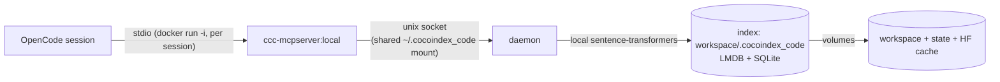

# CocoIndex Code MCP (`cocoindex-code`)

AST-aware semantic code search for the engine stack, run as a standalone container: `ccc` chunks source files along AST boundaries, embeds them locally, and serves semantic search over the result.


## Description

The stack already owns exact-symbol lookup and impact analysis (lean-ctx), workspace docs discovery (rag), and external library docs (context7). `ccc` owns meaning-level code retrieval: it answers "where is the code that does X" questions that a token search misses and that a workspace-wide grep answers badly.

This folder containerizes what the opencode image currently bakes in (`pipx install cocoindex-code[full]` in `agents/opencode/Dockerfile`). Both paths exist side by side: the legacy in-image `ccc mcp` stays active and boot-required until the config entry is switched to the container command below.

This folder lives outside `agents/opencode/` on purpose: it is host tooling, not engine payload.

## Table of Contents

- [Quick Start](#quick-start)
- [Configuration](#configuration)
- [Switching the config entry](#switching-the-config-entry)
- [Usage Examples](#usage-examples)
- [Architecture](#architecture)
- [Project Structure](#project-structure)
- [Troubleshooting](#troubleshooting)

## Quick Start

```bash
cd workspace/ai/mcp/cocoindex-code

# 1. Build the image (pinned wheel, CPU-only torch, ccc init baked)
docker build -t ccc-mcpserver:local .

# 2. Start the holder service (keeps daemon, index and model cache warm)
docker compose -f docker-compose.example.yaml up -d

# 3. Verify
docker exec cocoindex-code ccc doctor
```

The service is also declared in the parent stack's `docker-compose.example.yaml` behind `profiles: ["ccc"]`, so it never auto-starts alongside the legacy in-image daemon:

```bash
docker compose --profile ccc up -d --build cocoindex-code   # from the repo root
```

First `ccc index` embeds everything and downloads the embedding model once (the only network dependency after the build); later runs are incremental.

## Configuration

### Environment variables

| Variable | Required | Default | Description |
|---|---|---|---|
| `CCC_WORKSPACE_DIR` | No | `/home/node/workspace` | Project root that gets indexed (bind-mounted at the same path so index paths stay valid) |
| `CCC_STATE_DIR` | No | `/home/node/.cocoindex_code` | Global settings, daemon socket, daemon state |
| `CCC_MODEL_CACHE_DIR` | No | `/home/node/.cache/huggingface` | HuggingFace model cache (one-time ~88 MB download) |
| `COCOINDEX_CODE_VERSION` | No | `0.2.43` | Build arg: pinned `cocoindex-code` wheel |

Behind a corporate TLS proxy, drop PEM certificates into the gitignored `certs/` directory before `docker build` (same pattern as `agents/opencode/Dockerfile`). The image runs `update-ca-certificates` and points `PIP_CERT` / `SSL_CERT_FILE` at the resulting bundle. Without the corporate CA, pip fails with `ssl-verification-failed` while fetching torch.

### Model settings

| Setting | Where | Description |
|---|---|---|
| `embedding.model` | `~/.cocoindex_code/global_settings.yml` | Sentence-transformers model (`Snowflake/snowflake-arctic-embed-xs`, 384 dims) |
| `COCOINDEX_CODE_EMBEDDING_MODEL` | env var | Env override for model selection |
| `COCOINDEX_LMDB_MAP_SIZE` | env var, bytes | Raises the LMDB map size (fix for map-full on large repos) |

## Switching the config entry

`config-entry.json` holds the ready-to-use container command. The switch is deliberate and separate from this PR:

1. Build the image and start the holder (`Quick Start`).
2. Replace the `mcp.servers.cocoindex-code` command in `agents/opencode/config/opencode.json` with the contents of `config-entry.json`.
3. Restart OpenCode and verify the MCP handshake.
4. Only then (a follow-up PR) remove the pipx bake from `agents/opencode/Dockerfile` and drop `cocoindex-code` from the boot-required list in `engine/scripts/boot/mcp-check.sh` (demote to warn-only, like falkordb).

The per-session container reaches the daemon through the shared `~/.cocoindex_code` mount (unix socket), so the config command needs no docker network. All three mounts default to the live paths, so the existing 152 MB index and 88 MB model cache are reused with zero re-embedding.

## Usage Examples

```bash
# ranked matches with paths and line ranges
ccc search "where is the MCP server registered"

# first run embeds everything
ccc index /home/node/workspace

# structural grep, no index needed
ccc grep "def parse_" --lang python
```

MCP tools exposed to agents: `cocoindex-code_search` (semantic search), `cocoindex-code_grep` (AST-structural grep).

## Architecture



- The MCP server process is stateless and short-lived: one container per session, torn down on session end (`--rm`).
- The daemon, index and model cache are long-lived and live in bind mounts: `restart: unless-stopped` holder service keeps them warm, and the daemon self-heals (`ccc daemon status` respawns it).
- `ccc mcp` must run with the project as the working directory (`-w /home/node/workspace`), never from `/`.

## Project Structure

```
ai/mcp/cocoindex-code/
├── Dockerfile                  # ccc-mcpserver:local - pinned wheel, CPU torch, ccc init baked
├── docker-compose.example.yaml # holder service (daemon + index + model cache warm)
├── config-entry.json           # container command, ready for the config switch
└── README.md
```

## Troubleshooting

- **`ccc mcp` exits code 1 on connect** - global settings missing. The image bakes `ccc init`; if you mount an empty `CCC_STATE_DIR`, the mount shadows the baked settings. Point `CCC_STATE_DIR` at the real state dir or run `ccc init` once inside the container.
- **Search results are meaningless after a model switch** - embeddings from two models mixed in one index. Run `ccc reset && ccc index`.
- **LMDB map-full while indexing a large repo** - raise `COCOINDEX_LMDB_MAP_SIZE`.
- **`ccc --version` exits 2** - the CLI has no `--version` flag; use `ccc version`.

## Notes

- Legacy path: the opencode image bakes the same wheel (`agents/opencode/Dockerfile`, `ARG COCOINDEX_CODE_VERSION`) and `boot/mcp-check.sh` treats `cocoindex-code` as boot-required. Those stay untouched in this PR; see [Switching the config entry](#switching-the-config-entry).
- House docs for the baked variant: [`agents/opencode/supports/cocoindex/README.md`](../../agents/opencode/supports/cocoindex/README.md).
