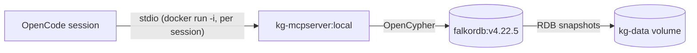

# FalkorDB Knowledge Graph MCP

Governance fact graph for the workflow-state-engine: entities and typed relations, queried with OpenCypher, run entirely as containers.


## Description

The engine stack already has semantic recall (lean-ctx `ctx_knowledge`), a code graph (`ctx_callgraph` / `ctx_impact`), and workspace retrieval (rag). What it lacks is an entity-relation fact layer: which decision touched which file, which PR closed which finding, which lesson prevents which failure class. This integration provides that layer as a FalkorDB graph database plus a per-session MCP server container. There is no AI in the loop server-side; the calling agent writes the Cypher.

This folder lives outside `agents/opencode/` on purpose: it is host tooling, not engine payload.

## Table of Contents

- [Quick Start](#quick-start)
- [Configuration](#configuration)
- [Usage Examples](#usage-examples)
- [Governance Schema](#governance-schema)
- [Architecture](#architecture)
- [Project Structure](#project-structure)
- [Troubleshooting](#troubleshooting)
- [Notes](#notes)

## Quick Start

```bash
cd workspace/ai/mcp/falkordb

# 1. Build the custom MCP server image (pinned, stdio baked)
docker build -t kg-mcpserver:local .

# 2. Start the DB (health-gated; returns on engine restarts via restart policy)
docker compose -f docker-compose.example.yaml up -d

# 3. Verify
docker exec falkordb redis-cli ping
```

Expected: `PONG`. The `falkordb` MCP entry in `agents/opencode/config/opencode.json` then connects on the next OpenCode session. Until the DB runs, the boot preflight (`boot/mcp-check.sh`) warns only - the server is optional, not baked.

## Configuration

### Environment variables

| Variable | Required | Default | Description |
|---|---|---|---|
| `KG_HOST_PORT` | No | `4679` | Host port for the DB (loopback only) |
| `KG_DATA_DIR` | No | `/home/node/workspace/kg-data` | Bind mount for RDB snapshots; survives `compose down` |
| `KG_NETWORK` | No | `utility_default` | Root stack network the DB joins; override when your stack runs under a different name |

### MCP registration

`config-entry.json` is the canonical `.mcp.servers.falkordb` entry, registered centrally in `agents/opencode/config/opencode.json`:

| Field | Value | Notes |
|---|---|---|
| type | `local` | stdio transport |
| command | `docker run -i --rm --network utility_default ... kg-mcpserver:local` | Per-session container; joins the same stack network as the DB |
| env | `FALKORDB_HOST=falkordb`, `FALKORDB_PORT=6379`, `MCP_TRANSPORT=stdio` | Service name resolution; stdio is explicit because the upstream image bakes `http` |

To change the network, edit both the compose override (`KG_NETWORK`) and the `--network` flag in the config entry - the two must match.

## Usage Examples

```cypher
// Which lessons guard against a failure class a PR recently hit?
MATCH (l:Lesson)-[:PREVENTS]->(f:FailureClass)<-[:CAUSED]-(pr:PR)
WHERE f.name = 'compile' RETURN l.key, pr.number ORDER BY pr.merged_at DESC;

// Files a decision and its superseding decision jointly touched
MATCH (d2:Decision)-[:SUPERSEDES]->(d1:Decision)-[:TOUCHES]->(f:File)
WHERE d1.id = 'orchestration-contract' RETURN d2.id, collect(f.path);

// Open findings by severity, with the PR that will close them
MATCH (f:Finding) OPTIONAL MATCH (pr:PR)-[:CLOSES]->(f)
RETURN f.severity, f.id, pr.number ORDER BY f.severity;
```

MCP tools available to agents: `query_graph`, `query_graph_readonly` (parameterized Cypher), `get_graph_schema`, `get_node_schema`, `get_relationship_schema`, `list_graphs`, `delete_graph`.

## Governance Schema

| Node | Key properties |
|---|---|
| `(:Decision {id})` | date, summary, state |
| `(:PR {number})` | title, merged_at, sha |
| `(:Finding {id})` | severity, stage, status |
| `(:File {path})` | - |
| `(:Lesson {key})` | claim, verified_by |
| `(:FailureClass {name})` | - |

| Relation | Meaning |
|---|---|
| `(Decision)-[:TOUCHES]->(File)` | files in scope of a decision |
| `(PR)-[:CLOSES]->(Finding)` | review finding dispositioned by a PR |
| `(PR)-[:MERGED_AS]->(Decision)` | PR that landed a decision |
| `(Lesson)-[:PREVENTS]->(FailureClass)` | what a lesson guards against |
| `(Decision)-[:SUPERSEDES]->(Decision)` | decision lineage |

## Architecture



- The MCP server is stateless and short-lived: one container per session, torn down when the session ends (`--rm`).
- The DB is long-lived: pinned upstream image, health-gated, `restart: unless-stopped`.
- Service, container, and network names (`falkordb`, `utility_default`) are the contract between compose and the config entry.

## Project Structure

```
ai/mcp/falkordb/
├── Dockerfile                  # kg-mcpserver:local - pinned upstream + stdio baked
├── docker-compose.example.yaml # DB + optional debug profile (MCP over HTTP)
├── config-entry.json           # canonical .mcp.servers.falkordb snippet
└── README.md
```

## Troubleshooting

- **Boot preflight warns `falkordb: no initialize response`** - the DB container is not running. Start it (`docker compose -f docker-compose.example.yaml up -d`); the warning is non-fatal by design.
- **Handshake works but queries fail with connection refused** - the MCP container and the DB are on different networks. `--network` in the config entry must match the network the compose file attached the DB to (`KG_NETWORK`).
- **`MCP_TRANSPORT` seems ignored / HTTP endpoints appear** - you are on the upstream image without the explicit `-e MCP_TRANSPORT=stdio`; it bakes `http` as default. Use the config entry verbatim or the custom image.
- **Graph is empty after restart** - check `KG_DATA_DIR`; data lives only in that bind mount. `docker compose down` never deletes it.

## Notes

- This is a deliberate graph-memory integration, distinct from the official `server-memory` package (which this project does not ship).
- The graph complements, never replaces: lean-ctx `ctx_knowledge` (semantic recall), `ctx_callgraph` / `ctx_impact` (code graph), and rag (workspace retrieval). It is the entity-relation layer between them.

## Contributing

Internal tooling - no external contributions. Changes land via gated PRs to the `utility` repository; CI runs T20 (inventory + hygiene guards) against this folder.
