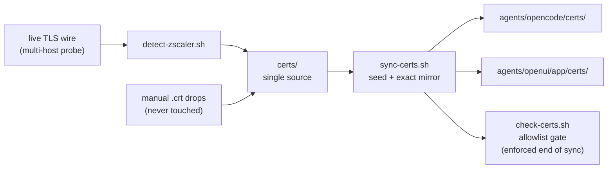

# certs

Single source for corporate CA certificates feeding every image build.

<p>
  
  
  
  
</p>

Behind a TLS-inspecting proxy (Zscaler and friends), every HTTPS chain
presents the proxy's own certificate instead of the real site CA, so the
intercepting cert can be read straight off the wire. All interception certs
and manual corporate roots live HERE and only here. The submodule cert dirs
(`agents/opencode/certs`, `agents/openui/app/certs`) are mirrors, not
sources: they are refreshed by `sync-certs.sh` and must never be edited
directly, because the Dockerfiles `COPY certs/` from them at build time.

## Table of Contents

1. [Quick Start](#quick-start)
2. [How the pipeline works](#how-the-pipeline-works)
3. [CERTS_GATE_REQUIRED](#certs_gate_required)
4. [How to add a cert](#how-to-add-a-cert)
5. [Manual vs autodetected](#manual-vs-autodetected)
6. [Rotation](#rotation)
7. [Cross-platform (macOS / Linux / Windows)](#cross-platform-macos--linux--windows)
8. [Git policy](#git-policy)
9. [Contributing and License](#contributing-and-license)

## Quick Start

```bash
sh certs/sync-certs.sh    # seed (if empty) + mirror to all submodules
```

Run it before `docker build`. In practice you rarely call it by hand:
`agents/opencode/populate-preinstall.sh` runs the detector and the sync on
every populate run, so certs refresh whenever the offline store is updated.

## How the pipeline works

| Script | Role |
|---|---|
| `detect-zscaler.sh` | Probes live hosts over TLS, extracts every chain cert that mentions Zscaler, saves them fingerprint-deduped as `zscaler-autodetected-*.crt` |
| `sync-certs.sh` | Seeds the parent dir via the detector when empty, then mirrors the exact parent set into every submodule cert dir (stale target certs are removed) |
| `check-certs.sh` | Allowlist gate: every `.crt` must match `certs-allowlist.txt`; unexpected files fail the check |

The detector probes multiple hosts on every run, because Zscaler hands out
different issuer chains per site: one probe host under-covers what clients
actually contact (github.com probed alone is why the torch CPU wheel index
once failed pip while pypi.org kept working; some hosts are bypassed by
proxy policy and present clean chains). All certs found across intercepted
hosts are merged into one deduped set.

Exit codes of the detector: `0` interception found (autodetected set
refreshed), `1` probes ran and no host shows interception (stale
autodetected certs removed; manual certs untouched), `2` environment failure
(openssl missing, no host reachable, or nothing extractable; the cert store
is left untouched).

The sync is seed-then-mirror: on a fresh checkout with an empty parent, the
detector seeds it first; a detector environment error (exit 2) aborts the
sync with targets untouched. After mirroring, the sync runs the allowlist
check itself and fails on any non-allowlisted cert; this is the enforcing
call, because it is where certs actually land on every populate run.

## CERTS_GATE_REQUIRED

`agents/opencode/populate-preinstall.sh` runs the detector, then the sync,
then re-runs the allowlist check directly (the sync itself stays
best-effort: the seeding detector can fail for benign environment reasons).
If that re-run finds a non-allowlisted cert:

| Setting | Behavior |
|---|---|
| `CERTS_GATE_REQUIRED=1` (default) | Populate aborts; a smuggled CA cannot enter the store or the image |
| `CERTS_GATE_REQUIRED=0` | Populate continues with a warning; not recommended, since Dockerfile `COPY certs/` would trust it |

In CI, validate.yml runs `check-certs.sh` as a tracked-inventory sanity
check on the committed state: it verifies the tracked cert names match the
allowlist (there is no live cert set in CI; content is gitignored). The
enforcing copy of the same check runs where certs actually land, at the end
of `sync-certs.sh` and inside every populate run.

## How to add a cert

1. Drop your `.crt` into this folder (`certs/`). Any file that is not
   `zscaler-autodetected-*.crt` is a manual cert: the detector and the sync
   never modify or remove it.
2. Add the file name to `certs-allowlist.txt` (one pattern per line; the
   check fails otherwise) - unless it is a Zscaler root named
   `zscaler-root-*.crt`, which is pre-allowlisted.
3. Run `sh certs/sync-certs.sh` (or re-run the populate script) to mirror it
   into the submodule cert dirs, then rebuild.
4. Commit the allowlist entry, never the cert content.

## Manual vs autodetected

- `zscaler-autodetected-*.crt`: output of `detect-zscaler.sh`. Deleted and
  rewritten on every interception-found run. Never edit.
- Any other `*.crt`: manual certs (exported corporate roots). Never touched
  by the detector or the sync; survive rotation.
- `zscaler-root-*.crt`: the manually exported Zscaler ROOT CA - keep at
  least one. The proxy rarely sends the root on the wire, so the
  autodetected set is usually intermediates only, and intermediates alone
  anchor just the probed hosts. Export the root once, save it under this
  name, and it survives every detector run; the detector prints which
  root anchors the set and warns loudly when there is none. If you
  previously dropped a root as `zscaler-autodetected-*.crt`, RENAME it
  (e.g. to `zscaler-root-ca.crt`) - the detector deletes that whole
  prefix on every run.

## Rotation

Corporate MITM roots rotate: new intermediates, new pinning, and a
once-captured cert goes stale silently. The probe runs on EVERY invocation
and the autodetected set is replaced, not appended to, so a scheduled re-run
keeps the store trusted (this is why populate calls the detector
unconditionally). Re-run the detector (or `sync-certs.sh`, or
`populate-preinstall.sh`) to re-derive the autodetected set from the live
wire; manual certs survive untouched.

## Cross-platform (macOS / Linux / Windows)

All scripts here are POSIX `sh` and must stay LF-only: `.gitattributes`
enforces `eol=lf` for `*.sh` and `certs-allowlist.txt` (`*.crt` is binary).
Two runtime safety nets cover checkouts or editors that slip CRLF past git:
every script detects `\r` in itself and re-execs an LF copy, and the entry
points (`sync-certs.sh`, the populate script) normalize any CRLF-mangled
script or the allowlist in place before running them; the allowlist gate
additionally strips `\r` from patterns while reading. `test-eol-robustness.sh`
proves the whole chain against deliberately CRLF-mangled copies. Windows is
supported through Git Bash or WSL only - native cmd/PowerShell cannot run
`sh`. Nothing else about the pipeline is platform-specific.

## Git policy

Cert CONTENT here is gitignored by design: corporate certs are never
committed. The two scripts (`detect-zscaler.sh`, `sync-certs.sh`),
`check-certs.sh` with `certs-allowlist.txt`, and this README are tracked
(see the `.gitignore` negations).



## Contributing and License

This is an internal repository and is not open for external contribution.
Changes are made in place through pull requests, which run the validate
workflow automatically (including the cert allowlist sanity check). No
LICENSE file ships with the repository; treat the contents as proprietary
and for internal use only.
