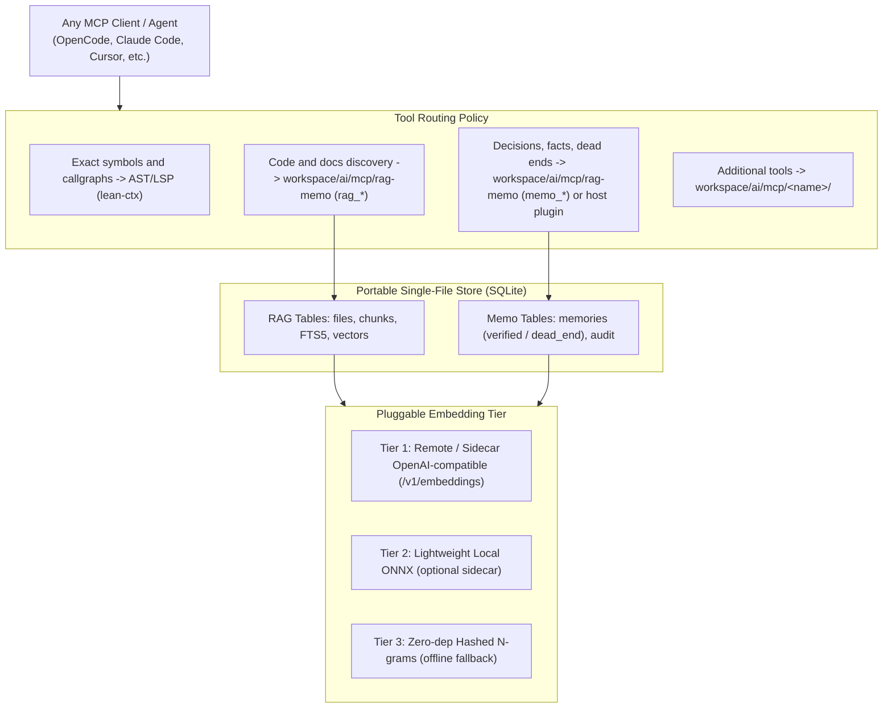

# Agnostic RAG and Memo Architecture Plan

Implementation plan for an effective, efficient, and tool-agnostic **Semantic Search (RAG)** and **Agent Memory (Memo)** layer that replaces `cocoindex-code` (`ccc`) while remaining portable across any MCP-compatible agent or plugin runtime.

---

## 1. Goals and Design Principles

1. **Zero heavy runtime bloat:** Eliminate PyTorch, `transformers`, `sentence-transformers`, and 1-hour CPU indexing timeouts.
2. **Agnostic and generic:** No vendor lock-in to a specific agent framework, model provider, or git repository layout.
3. **Standard module layout (`workspace/ai/mcp/<name>/`):** Package any optional or standalone MCP tool under `workspace/ai/mcp/<name>/` (with `Dockerfile`, `docker-compose.example.yaml`, `config-entry.json`, and `README.md`), matching `workspace/ai/mcp/falkordb/`.
4. **Effective over complex:** Pair deterministic keyword + structural chunking with optional neural embeddings rather than relying on heavy background daemons.
5. **Pluggable backends:** Support swapping embedding providers or delegating memory to an existing MCP/plugin without changing agent prompts.

---

## 2. High-Level Architecture



---

## 3. Component 1: Generic Hybrid RAG

Replaces `cocoindex-code` (`ccc`) by upgrading the zero-dependency SQLite FTS5 + vector pattern (`workspace/agents/opencode/rag/server.js`) and exposing it as a reusable `workspace/ai/mcp/rag-memo/` module.

### Key Capabilities
- **Structure-aware chunking (no PyTorch required):**
  - *Markdown:* Split by heading hierarchy (`h1 > h2 > h3`).
  - *Source code:* Lightweight boundary chunkers (function, class, method, and block boundaries) for Java, JS/TS, Python, Shell, and Go, attaching `file > scope > symbol` headers.
  - *Config / Text:* Paragraph and key-block boundaries.
- **Hybrid Retrieval + Reciprocal Rank Fusion (RRF):**
  - Combine **FTS5 BM25** (exact identifiers, error strings, flags) with **Cosine Vector Similarity** (conceptual queries).
  - Use RRF or configurable weighted fusion (`0.6 BM25 + 0.4 Vector`) with a minimum score floor to suppress noise.
- **Incremental Hash-Based Sync:**
  - Track SHA-256 hashes per file. Skip unchanged files, re-chunk modified ones, and purge deleted paths.
  - Works on any directory tree (removes the `.git` and `repos/utility` canonical-clone dependency).
- **Pluggable Embeddings:**
  - Read `RAG_EMBEDDINGS_URL`, `RAG_EMBEDDINGS_MODEL`, and `RAG_EMBEDDINGS_KEY`.
  - Default to zero-dependency offline hashed vectors when unset; switch to any OpenAI-compatible endpoint (OpenRouter, Ollama, FastEmbed sidecar, vLLM) when configured.

### Standard Generic MCP Surface (`rag_*`)
| Tool | Inputs | Purpose |
|---|---|---|
| `rag_search` | `query`, `k`, `glob`, `min_score` | Hybrid FTS5 + vector search with path filtering |
| `rag_index` | `root`, `force` | Incremental file-hash reindex of a target directory |
| `rag_get` | `id` | Fetch full chunk content by chunk ID |
| `rag_status` | none | Report DB path, file/chunk counts, stale count, and embedding mode |

---

## 4. Component 2: Generic Write-Gated Memo

Separates **long-term agent memory** from **document/code search** so stale chat logs never masquerade as source truth.

### 3-Tier Memory Model
1. **Working Memory (Session):** Ephemeral task state and scratchpads (`session/contract.json`, `session/state.md`). Not stored in long-term Memo.
2. **Episodic Memory (`dead_end` & Decisions):** Records failed approaches and architectural decisions. Entries tagged `dead_end` are excluded from positive guidance and surfaced only as warnings when an agent is about to repeat a failed path.
3. **Semantic / Procedural Memory (`verified`):** Durable project conventions, build quirks, and user preferences.

### Efficiency and Anti-Bloat Rules
- **Write Gate:** Every write requires `category`, `key`, `tag` (`verified` | `observed-once` | `dead_end`), `rationale`, and `source_task`.
- **Recall-Before-Write (Dedup):** Upsert on `(category, key)` instead of appending duplicate notes.
- **Bounded Compaction:** Enforce a per-category entry cap (for example, 50 entries) using oldest-first compaction for `observed-once` items while preserving `verified` rules.
- **File-Linked Staleness:** Optional `ref_path` + `ref_hash` field; if the referenced file changes on disk, mark the memo entry `needs_reverify` on recall.

### Standard Generic MCP Surface (`memo_*`)
| Tool | Inputs | Purpose |
|---|---|---|
| `memo_recall` | `query`, `category`, `include_dead_ends` | Hybrid search over curated memories |
| `memo_remember` | `category`, `key`, `content`, `tag`, `rationale` | Write-gated upsert with dedup check |
| `memo_forget` | `category`, `key` | Explicit deletion of obsolete entries |
| `memo_status` | none | Counts by category and tag, plus stale entry warnings |

---

## 5. Modular Packaging Under `workspace/ai/mcp/<name>/`

Any external or optional MCP tool added to the workspace follows the standard module layout under `workspace/ai/mcp/<name>/`:

```text
workspace/ai/mcp/<name>/
├── README.md                    # Purpose, tools, env vars, and quick start
├── Dockerfile                   # Minimal container image (stdio MCP default)
├── docker-compose.example.yaml  # Standalone compose + optional sidecar services
└── config-entry.json            # Drop-in mcp.servers entry for opencode.json / MCP clients
```

### Plugin / MCP Coexistence
- **Unified SQLite Store, Toggleable Tools:** `workspace/ai/mcp/rag-memo/` runs as a single lightweight Node.js MCP server backed by `node:sqlite` with separate tables (`chunks` vs `memories`).
- **External Plugin / MCP Override:** If a host runtime already provides a dedicated memory tool (such as `lean-ctx` knowledge tools, Mem0, or another MCP plugin), set `MEMO_ENABLED=false` so the server exposes only `rag_*` while memory routes to the host's preferred plugin.
- **Adding Future Tools:** Place new MCP servers (for example, a lightweight ONNX embeddings sidecar or specialized domain MCP) under `workspace/ai/mcp/<name>/` and merge their `config-entry.json` into the active agent config without bloating the base `opencode` image.

---

## 6. Phased Implementation Plan

### Phase 1: Remove `cocoindex-code` Bloat
- [ ] Remove `cocoindex-code`, `torch`, `transformers`, and `sentence-transformers` from `workspace/agents/opencode/Dockerfile` and `populate-preinstall.sh`.
- [ ] Remove the `cocoindex-code` entry from `workspace/agents/opencode/config/opencode.json` and `engine/opencode.json.template`.
- [ ] Archive or remove `workspace/agents/opencode/supports/cocoindex/` (and deprecate `workspace/ai/mcp/cocoindex-code/`).
- [ ] Update `engine/scripts/boot/mcp-check.sh` and `health-check.sh` to drop `ccc` expectations.

### Phase 2: Upgrade `rag/server.js` for Multi-Language Code + Better Scoring
- [ ] Add boundary-aware code chunkers for JS/TS, Python, Shell, and Go (matching the existing `chunkJava` pattern).
- [ ] Switch fusion scoring to RRF or tuned BM25 + vector blending with a configurable `min_score` filter.
- [ ] Add tests in `workspace/agents/opencode/rag/test.sh` covering JS/TS, Python, and Shell chunking and incremental purge behavior.

### Phase 3: Generic Memo Layer & `workspace/ai/mcp/rag-memo/` Packaging
- [ ] Wire `rag-memo` server code into `workspace/ai/mcp/rag-memo/` (or share `/opt/rag/server.js`) with `MEMO_ENABLED=true|false`.
- [ ] Implement `memo_*` tools with write-gate validation, recall-before-write dedup, and `dead_end` filtering.
- [ ] Merge `workspace/ai/mcp/rag-memo/config-entry.json` into target MCP clients as needed.

### Phase 4: Update Routing Docs and Verify
- [ ] Rewrite `workspace/agents/opencode/docs/semantic-index-routing.md` to reflect the new routing table (removing `ccc` and `repos/utility` requirements).
- [ ] Update `workspace/agents/opencode/engine/agent.md` and `README.md` tool tables.
- [ ] Run full validation (`check-cross-references.sh`, `check-doc-style.sh`, `rag/test.sh`, and Docker offline build check).
