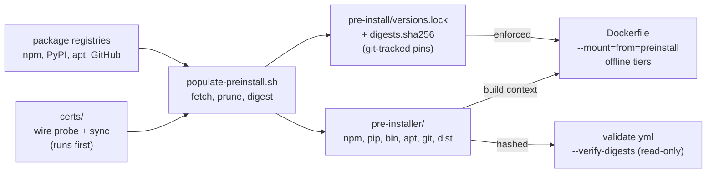

# pre-installer

Offline package store that feeds the Docker builds: once this folder is
populated, images build with no network access.

<p>
  
  
  
  
</p>

This folder is the single source shared by all submodules. It mirrors apt
`.deb` pools, npm tarballs, pip wheels, git repo mirrors (`git/`), standalone
binaries (`bin/`), and platform dist tarballs (`dist/`) onto local disk, and
the Dockerfile mounts it as the `preinstall` build context for every offline
install tier. Its contents are never committed (gitignored by design); the
only git-tracked record is `agents/opencode/pre-install/versions.lock`, which
holds the resolved versions of the last populate run. The store is the
lockfile: rebuilds alone never move a version, a populate run does.

## Table of Contents

1. [Quick Start](#quick-start)
2. [What the store holds](#what-the-store-holds)
3. [Who consumes it](#who-consumes-it)
4. [Digest pinning](#digest-pinning)
5. [Configuration](#configuration)
6. [Portability](#portability)
7. [Architecture](#architecture)
8. [Contributing and License](#contributing-and-license)

## Quick Start

From the repository root:

```bash
docker compose -f docker-compose.example.yaml --profile tools run --rm opencode-preinstall
# or, without compose (needs network + sh):
sh workspace/agents/opencode/populate-preinstall.sh
```

The populate script fetches every artifact once, then stays idempotent and
version-aware: same-version artifacts are skipped, changed versions are
re-fetched, and stale copies are pruned (single-match globs in the Dockerfile
tiers break if two versions of one package sit in the store). The cert
refresh (wire probe plus `certs/sync-certs.sh`) runs before the downloads so
corporate MITM proxies are trusted. Resolved versions land in
`agents/opencode/pre-install/versions.lock`.

## What the store holds

| Section | Content | Consumed by |
|---|---|---|
| `npm/` | npm tarballs (opencode CLI platform packages, MCP servers, lean-ctx deps) | Dockerfile npm tiers |
| `pip/` | pip wheels (MCP Python SDK, fetch server) | Dockerfile pip tiers |
| `bin/` | standalone binaries (lean-ctx, firecrawl-cli, ast-grep) | Dockerfile bin tiers |
| `apt/` | `.deb` pool | Dockerfile apt tier |
| `git/` | git repo mirrors | Dockerfile git tiers |
| `dist/` | platform dist tarballs | Dockerfile dist tiers |

The ML closure (torch, transformers) is skip-if-present because it is large
and slow to re-fetch; set `REFRESH_ML=1` to force a refresh.

## Who consumes it

- `agents/opencode/Dockerfile`: every offline tier mounts the store via
  `--mount=from=preinstall` (build additional context `preinstall`).
- `agents/opencode/docker-compose.example.yaml` and the repository-root
  `docker-compose.example.yaml`: `build.additional_contexts.preinstall`
  points at this folder.

Without the store, installs fall back to the network and fail in offline
environments.

## Digest pinning

Every store artifact is pinned by sha256 in
`agents/opencode/pre-install/digests.sha256`
(`<sha256>  <store-relative-path>`, one line per file). Recorded digests are
enforced: a mismatch aborts the run and the file is quarantined (moved to
`.quarantine`, invisible to the Dockerfile globs). Unrecorded artifacts warn
in populate mode and fail the gate in verify mode.

Three modes of `agents/opencode/populate-preinstall.sh`:

| Mode | What it does | Where it runs |
|---|---|---|
| `populate` (default) | Fetch artifacts, then re-verify every recorded digest at the end of the run (skip path included) and warn on unpinned store files | Local / preinstall container, with network |
| `--verify-digests` | Offline gate: no network, no resolvers. Exits 1 on a mismatch (quarantine), a missing pinned file, or a store file with no manifest entry | Local or CI; read-only |
| `--update-digests` | Maintainer path: after fetchers run, regenerate the manifest from the current store (sorted, deduped). Not an append: a bump must not leave a stale pin behind | Local, with network, never CI |

Pin policy in one line: a comment-only manifest pins nothing. A non-empty
store with zero recorded digests fails `--verify-digests` outright instead of
passing silently.

The TOFU window, named honestly: the FIRST fetch of an artifact cannot be
digest-verified, because there is no prior pin to check against (Trust On
First Use). The pins themselves come from a maintainer `--update-digests`
run on a trusted connection. After pins exist, every later populate run and
every `--verify-digests` gate re-hashes the files, so post-first-fetch
tampering is detected. First-fetch substitution is not; name that window when
reviewing store changes. Each dependency bump costs one re-pin
(`--update-digests`) plus one verify.

CI policy: verification runs on every push and pull request through the
"Offline store digest gate" in
[.github/workflows/validate.yml](../../.github/workflows/validate.yml)
(read-only, no writes). Digest deployment never runs on pull requests or
feature branches: the Cloudflare Pages digest publish lives in
[.github/workflows/deploy-digest.yml](../../.github/workflows/deploy-digest.yml)
and triggers only on push to `main` (plus manual `workflow_dispatch`), and
`--update-digests` is a maintainer local run, never a CI step.

The store build itself (`--verify-digests` inside the Dockerfile) fails on
any mismatch, missing pin, or unpinned artifact once the manifest has
entries.

## Configuration

Environment overrides for the populate script (see the script header for the
full list and rationale):

| Variable | Default | Purpose |
|---|---|---|
| `PREINSTALL_STORE` | `<workspace-root>/pre-installer` | Store location override for non-standard checkouts |
| `OPENCODE_VERSION` | resolve latest at populate time | OpenCode CLI pin (reproducibility escape hatch) |
| `OPENCODE_ARCH` | host `uname -m` (`x86_64` to `x64`, `aarch64` to `arm64`) | Platform package arch; stores are single-arch (mixed arches break npm at build) |
| `OPENCODE_PLATFORM_VERSION` | resolve latest | `@opencode/cli-linux-<arch>` pin |
| `CONTEXT7_VERSION` | resolve latest | `@upstash/context7-mcp` pin |
| `LEAN_CTX_VERSION` | resolve latest | lean-ctx binary pin |
| `MCP_VERSION` / `MCP_SERVER_FETCH_VERSION` | resolve latest | MCP Python SDK / fetch server pins |
| `AST_GREP_VERSION` | resolve latest | ast-grep binary pin |
| `ZOD_VERSION` / `FIRECRAWL_CLI_VERSION` | resolve latest | zod / firecrawl-cli pins |
| `CERTS_GATE_REQUIRED` | `1` | Set to `0` to continue populate despite a non-allowlisted cert (not recommended) |

Empty version vars mean "resolve latest below, after the CA-trust block";
env overrides win over resolution and are written to `versions.lock`.

## Portability

The store lives only on local disk / inside the workspace volume. To move it,
copy the workspace (the store comes with it). To start fresh, delete
sections and re-run the populate script; a mixed-platform store self-heals
on the next run (arch pruning). Only `versions.lock` and
`pre-install/digests.sha256` (pin manifest) are tracked; store contents
never are.

## Architecture



The populate script is the only writer; the Dockerfile and the CI gate are
readers. Pins recorded at populate time are re-hashed at every later build
and CI run.

## Contributing and License

This is an internal repository and is not open for external contribution.
Changes are made in place through pull requests, which run the validate
workflow automatically. Store contents are never committed; pin manifests
and version locks are reviewed in PRs. No LICENSE file ships with the
repository; treat the contents as proprietary and for internal use only.
