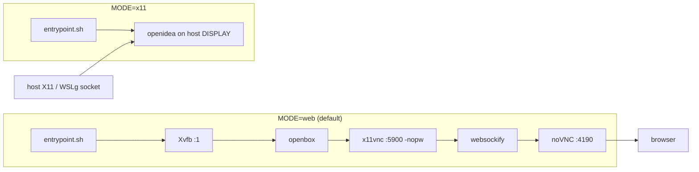

<!-- omit from toc -->
<a id="readme-top"></a>
# OpenIDEA in Docker

[OpenIDEA](https://github.com/l0ng-ai/openidea) is an IntelliJ-style IDE written in Rust and Tauri. This folder packages it as a Debian container with two display modes on one image.

<p>
  
  
  
  
</p>

The image builds from the newest GitHub release unless you pin a version in `OPENIDEA_VERSION`. Display mode is chosen at runtime: `web` runs a virtual X server plus noVNC, `x11` attaches to a host X11 or WSLg socket.

| MODE | How you see it |
|------|----------------|
| `web` (default) | Xvfb, openbox, x11vnc, noVNC. Open `http://127.0.0.1:4190/vnc.html` |
| `x11` | Mounted host X11 or WSLg socket plus `DISPLAY`. No VNC stack |

<p align="right">(<a href="#readme-top">back to top</a>)</p>

## Contents

| Path | Purpose |
|------|---------|
| `Dockerfile` | Image build: GTK3/WebKitGTK runtime, VNC stack, IDE `.deb`, static Docker CLI |
| `docker-compose.example.yaml` | Standalone compose with `web` and `x11` profiles |
| `entrypoint.sh` | Mode dispatch: starts the VNC chain for `web`, execs the IDE for `x11` |
| `certs/` | Corporate CA drop-in (`.crt`, gitignored), trusted before any network fetch |
| `project/` | Mounted at `/home/ide/project` inside the container |

## Quick start (web mode)

```bash
cp -r /path/to/existing/repo project/          # or start empty
docker compose -f docker-compose.example.yaml --profile web up -d --build
```

Open <http://127.0.0.1:4190/vnc.html>. The port publishes on `127.0.0.1` only, because x11vnc runs with `-nopw`. Do not widen the binding without adding `-rfbauth`.

Pin a release instead of tracking latest:

```bash
OPENIDEA_VERSION=0.1.44 docker compose -f docker-compose.example.yaml --profile web up -d --build
```

## Quick start (x11 mode)

```bash
docker compose -f docker-compose.example.yaml --profile x11 up
```

WSLg hosts work as-is. On plain Linux, allow local clients first and remove the WSLg mount (see troubleshooting item 4).

## Configuration

Environment variables, all optional:

| Variable | Default | Description |
|----------|---------|-------------|
| `MODE` | `web` | `web` runs the VNC stack, `x11` attaches to a host socket |
| `NOVNC_PORT` | `4190` | noVNC listen port, web mode only |
| `OPENIDEA_VERSION` | `""` | Release to build. Empty means newest at build time (resolved `v0.1.44` during verification) |
| `DISPLAY` | `:1` web, `:0` x11 | X display. Web mode owns `:1` |
| `XVFB_GEOMETRY` | `1440x900x24` | Virtual screen size, web mode only |
| `OPENIDEA_BIN` | `openidea` | Override the IDE binary path (debugging) |

Volumes:

| Host path | Container path | Required | Description |
|-----------|----------------|----------|-------------|
| `./project` | `/home/ide/project` | yes | Your code. Owned by uid 1000 inside the container |
| `openidea-config` (named) | `/home/ide/.config/OpenIDEA` | no | IDE settings, survives rebuilds |
| `/var/run/docker.sock` | `/var/run/docker.sock` | no | Drives the IDE Docker dashboards |
| `/tmp/.X11-unix` | `/tmp/.X11-unix` | x11 only | Host X11 socket |
| `/mnt/wslg` | `/mnt/wslg` | x11 + WSLg only | WSLg socket and runtime dir |
| `./certs/*.crt` | baked at build | behind TLS interception | Corporate CA trust |

Ports:

| Port | Service |
|------|---------|
| `4190` | noVNC web UI (web mode). Published on loopback |
| `5900` | x11vnc, loopback inside the container only |

The runtime user is `ide`, uid and gid 1000, non-root.

<p align="right">(<a href="#readme-top">back to top</a>)</p>

## How it works



Build sequence:

1. Install GTK3, WebKitGTK and the VNC stack from `debian:bookworm-slim`.
2. Query the GitHub API for `releases/latest` and read the tag. An empty `OPENIDEA_VERSION` means newest.
3. Download `OpenIDEA_<version>_<amd64|arm64>.deb` and install with apt, which resolves declared dependencies.
4. Install the static Docker CLI, client only. It talks to the mounted host socket; there is no daemon in the image.

Architecture follows the build platform. `amd64` fetches the `amd64` asset and `arm64` fetches the `arm64` asset, so `--platform linux/arm64` on an arm64 host works without extra flags. The full build was verified at 1.88 GB with smoke tests, resolving v0.1.44.

<p align="right">(<a href="#readme-top">back to top</a>)</p>

## Corporate CA certificates

Behind a TLS-inspecting proxy the build cannot reach GitHub until the proxy root CA is trusted. Drop PEM files with a `.crt` extension into `certs/` before building:

```bash
cp /path/to/zscaler-root.crt certs/
```

The Dockerfile installs everything in `certs/` into the system trust store before the first network request. `certs/*.crt` is gitignored, only `.gitkeep` is tracked, and an empty directory changes nothing.

<p align="right">(<a href="#readme-top">back to top</a></p>

## Troubleshooting

These are the issues that actually came up while building and running the image.

**1. Build fails at the GitHub fetch behind Zscaler.**
The `releases/latest` API call or the `.deb` download returns a certificate error. Drop the proxy root CA into `certs/` as described above and rebuild. This was the demonstrated fix.

**2. The compose file has no CI schema check.**
Nothing validates the YAML on push. Run `docker compose -f docker-compose.example.yaml config` once after editing. It prints the resolved file and fails on schema errors before you spend a build cycle.

**3. `./project` becomes root-owned.**
If the container writes into the mount and the host copies end up owned by root, run:

```bash
sudo chown -R 1000:1000 project
```

The container user is non-root uid 1000, so the host directory must match.

**4. Plain Linux X11, not WSLg.**
Allow local clients, then remove the `/mnt/wslg` mount line from `docker-compose.example.yaml`:

```bash
xhost +local:
```

WSLg hosts keep the line as shipped.

<p align="right">(<a href="#readme-top">back to top</a>)</p>

## License

Upstream OpenIDEA is Apache-2.0. This packaging folder carries no separate license; treat it as internal tooling.

<p align="right">(<a href="#readme-top">back to top</a>)</p>